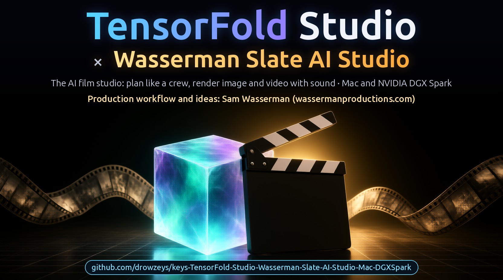
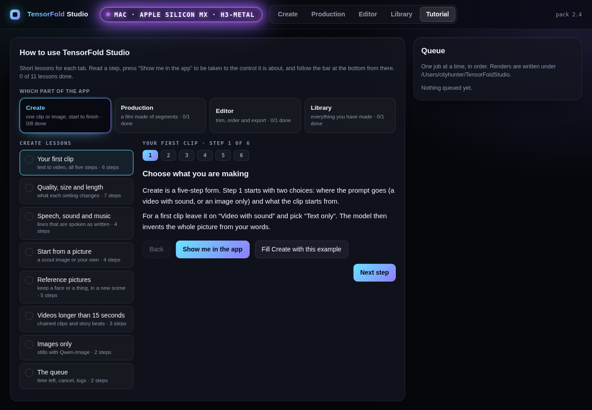

# keys+Wasserman Slate AI Studio, powered by TensorFold (Mac + DGX Spark)

**An AI film studio on your own machine: plan a film the way a crew does in the Wasserman Slate AI Studio, and render
it here. Qwen-Image-2.1-Turbo images and MiniMax H3 / FastH3 video with sound, on TensorFold: Apple-silicon Macs
(Metal) and the NVIDIA DGX Spark (CUDA).**

[](https://github.com/drowzeys/keys-Wasserman-Slate-AI-Studio-powered-by-TensorFold-Mac-DGXSpark)

*Banner art made with this studio's own Qwen-Image-2.1 step (1664x928, seed 25); the lettering was set afterwards.*

*Named at the request of the TensorFold project: this is an app built on TensorFold, not a TensorFold product.*

## Big credit: Sam Wasserman (wassermanproductions.com)

**Sam Wasserman shaped the production side of this studio: the AI film workflow and the ideas behind it.** Slate, his
prompt studio for AI filmmaking, is the workflow inside the Wasserman Slate AI Studio tab. The Wasserman Sharp Spec,
the QA gate that follows it, and the 80s Horror LoRA that opens the Keys and Wasserman LoRA Hub are his too. The Motion Previs tab's analysis is a
Python port of his [Motion Previs Studio](https://github.com/wassermanproductions/motion-previs-studio). The aim
we share is the best AI film studio there is, and this pack is where his planning tools meet a render engine. See
[CREDITS.md](CREDITS.md).

**Thank you to everyone this stands on:** the Qwen team at Alibaba (Qwen-Image-2.1, Qwen3-VL), the MiniMax team
(MiniMax H3), Ash Hart and the TensorFold contributors, antirez (h3.c), RobZombAI (H3MLX), mrbizarro (minimax-h3-mlx /
Phosphene), Filip Strand and the mflux contributors, Viggle (the image turbo adapter up to 2.2), speach1sdef178 (the 2x video
decoder), LightX2V (the video Turbo adapter), NVIDIA Research (Sol-Engine, Sol-Attn, Sol-H3), FastVideo (FastH3), and Apple's MLX team and every MLX
contributor. This pack is their work, ported, pinned and measured. See [CREDITS.md](CREDITS.md). Built with Qwen.

**2.6** · Apple-silicon Macs (measured on a Mac Studio M5 Ultra 256 GB) and the NVIDIA DGX Spark ·
[TensorFold](https://github.com/ashhart/TensorFold) **0.6.5** + two families, and TensorFold **1.0**'s native Zig
runtime for FastH3 on Metal and on CUDA:
**Qwen-Image-2.1-Turbo** (text to image) and **MiniMax H3** (video with sound) · int8 kernels on the M5 tensor units
and on the GB10's tensor cores · a 2x video decoder for 2K finals on the Mac

## Speed: the first version on each machine, and 2.3

One run each unless a range is given; 5 second clips are 124 frames. Mac: Mac Studio M5 Ultra, 256 GB. Spark: one
NVIDIA DGX Spark (GB10), models already loaded.

| 5 second clip, 864x480 | Mac, first version (1.0, 2026-10-04) | Mac, 2.3 | DGX Spark, first build (ComfyUI's own blocks, bf16) | DGX Spark, 2.3 |
|---|---|---|---|---|
| What makes the video | MiniMax H3 + Turbo adapter on MLX, 3 passes | FastH3, 8 passes, TensorFold's Zig + Metal engine | FastH3, 8 passes, ComfyUI | FastH3, 8 passes, TensorFold's CUDA engine in int8 |
| Image, then video from it | 74 s (103 s with the sound made again, the later default) | **79 s** (image 6 s, video 73 s) | 155 s | **115 s** (measured before the faster decoder below, which takes about 10 s more off) |
| Text straight to video | not offered | **66 s** | 118 to 121 s | **73 s** |
| One denoising pass | 9.5 s | **5.3 s** | 10.5 s | **7.1 s** |
| Video decode | not timed apart | 13 s | 26 s | **14 s** |

| Other sizes and lengths | Mac, first version | Mac, 2.3 | DGX Spark, first build | DGX Spark, 2.3 |
|---|---|---|---|---|
| 864x480, 4 passes, text to video | | 43 s | 71 s | 45 s (from the pass time) |
| 1280x720, 5 s, text to video | | 199 to 217 s | not measured | **183 s** |
| 1344x768, 5 s, text to video | | 175 s | 289 s | **about 195 s** |
| 1344x768, 8 s, image then video | 364 s (709 s with the later default) | not re-measured | | |
| 1280x720, 10 s (243 frames), text to video | | 378 s | not measured | 444 s |
| One 15 s part of a chained 864x480 clip | | about 249 s | not measured | about 304 s |
| One image, 1344x768 | 9.2 s (Viggle adapter, 6 steps) | **8.9 s** (Qwen-Image-2.1-Turbo, 8 steps; peak 15 GiB against 28) | 18 to 21 s with the model load | **9.5 s** |

- The Mac's first version and 2.3 use different video models, so the 74 s and 79 s rows are not the same work: the
  first is 3 passes of MiniMax H3 with its Turbo adapter, whose sound was judged poor by ear; 2.3 is 8 passes of
  FastH3 with its own sound. Per pass the Mac went from 9.5 s to 5.3 s.
- On the Spark the model is the same in both columns. The gain is the engine (10.5 s a pass to 7.1 s) and the 8-bit
  video decoder (26 s to 14 s).
- Both engines are TensorFold H3 families on the TensorFold 1.0.4 base, from one commit of one branch. 1.0.3 and 1.0.4
  are language-model releases, so the move changed nothing here: on each machine the same seed gives a bit-identical
  clip to the 1.0.2-based engine, at the same speed.

## Which Mac runs what

Every row is Studio **2.3**. "Default" means images (Qwen-Image-2.1-Turbo) and FastH3 video with sound, the web app and
the one-click app. Only the M5 Ultra with 256 GB has actually run it; every other row follows from memory measured
on that machine and is marked untested.

| Chip | Memory | What runs | Install command | Video engine it uses | Peak memory | Status |
|---|---|---|---|---|---|---|
| M5 family | 64 GB | Default | `bash oneshot-setup.sh --app` | FastH3, native Zig engine | 32 GiB | Untested |
| M5 family | 96 GB | Default | `bash oneshot-setup.sh --app` | FastH3, native Zig engine | 32 GiB | Untested |
| M5 family | 128 GB | Default, and MiniMax H3 Turbo if wanted | `bash oneshot-setup.sh --turbo --app` | FastH3 native; Turbo on the MLX engine with int8 kernels | 32 GiB; 103 GiB for Turbo | Untested |
| M5 family | 256 GB or more | Everything | `bash oneshot-setup.sh --turbo --app` | The same | The same | **Tested** (M5 Ultra, 256 GB) |
| M1 to M4 | 64 GB | Default, slowly | `bash oneshot-setup.sh --app` (add `Q8_ONLY=1` in front to save 65 GB of disk) | FastH3, MLX engine, 8-bit weights | 37 GiB at 480p, 40 GiB at 720p | Untested; emulated on the M5 |
| M1 to M4 | 96 GB | Default, slowly | `bash oneshot-setup.sh --app` | FastH3, MLX engine, 8-bit weights | 37 to 40 GiB | Untested; emulated on the M5 |
| M1 to M4 | 128 GB | Default, slowly. Turbo installs but is not recommended | `bash oneshot-setup.sh --app` | FastH3, MLX engine, 8-bit weights | 37 to 40 GiB | Untested; Turbo's memory without the int8 kernels is not measured |
| M1 to M4 | 256 GB or more | Default, slowly; Turbo should fit | `bash oneshot-setup.sh --turbo --app` | FastH3 MLX 8-bit; Turbo on the MLX engine in bfloat16 | 37 to 40 GiB; Turbo not measured | Untested |
| Any | 48 GB | Images only | `bash oneshot-setup.sh --image-only` | none | 28 GiB | Untested below 256 GB |

How to configure it:

- **Nothing to set on a normal install.** The setup reads the chip and the memory and picks the engine: the native
  engine on an M5, the 8-bit weights on an M1 to M4 (it converts them once, about 37 GB). It stops with a message if
  the Mac has too little memory for what was asked.
- **Disk:** 175 GB for the default on an M5; 212 GB on an M1 to M4 (147 GB with `Q8_ONLY=1`); 64 GB more with
  `--turbo`; 33 GB for `--image-only`.
- **Speed on an M1 to M4:** the 8-bit path took 31 s a pass at 864x480 on the M5 Ultra's GPU, against 5.3 s for
  the native engine there. An older GPU is slower again. Start with 480p, 5 seconds and 4 passes
  (`STEPS=4 bash scripts/fast.sh "a prompt" out.mp4`, or the 4 passes card in the app).
- **Overrides:** `FASTH3_Q8=0` runs an M1 to M4 with the uncompressed weights (64 GiB peak: a 96 GB Mac or larger;
  no faster). `FASTH3_ENGINE=mlx` forces the MLX engine on an M5. `ENGINE=h3` asks for Turbo where it is installed.

| Studio version | Smallest Mac for video |
|---|---|
| 2.0 and earlier | 128 GB (M5 for the fast path) |
| 2.1 | 64 GB on an M5; 96 GB on an M1 to M4 |
| 2.2 to 2.5 | 64 GB on any Apple silicon |

On a **DGX Spark** the setup asks for 100 GB of memory for video (a Spark has 128 GB; about 70 GB was in use during a
clip). No NVIDIA machine with 64 GB has been tried.

Measured memory for each kind of job is under [Minimum requirements](#minimum-requirements).

## DGX Spark (CUDA) build

The same Studio (web app, scripts, one-shot install) also runs on an **NVIDIA DGX Spark** (GB10, 128 GB unified
memory, CUDA 13). FastH3's transformer runs there on **TensorFold's H3 family for CUDA**: the Mac engine's design
(int8 projections, tile-routed int8 attention with FastH3's own sparse selection) on the GB10's tensor cores, written
in Zig over the CUDA driver. **ComfyUI**, pinned, hosts the rest: the text encoder, the sampler, the decoders and
Qwen-Image-2.1. The header of the web app says which build you are in: a green `DGX SPARK · NVIDIA GB10 · H3-CUDA`
badge, or a purple `MAC · APPLE SILICON MX · H3-METAL`.

**Thank you** to Ash Hart for TensorFold, FastVideo (Hao AI Lab) for FastH3 and its ComfyUI release, MiniMax for H3,
the Qwen team for Qwen-Image-2.1-Turbo, and the ComfyUI team for the runtime this build stands on.

```bash
git clone https://github.com/drowzeys/keys-Wasserman-Slate-AI-Studio-powered-by-TensorFold-Mac-DGXSpark.git && cd keys-Wasserman-Slate-AI-Studio-powered-by-TensorFold-Mac-DGXSpark
sudo apt install -y git ffmpeg
bash oneshot-setup.sh            # the same command as on a Mac: on Linux it runs oneshot-setup-spark.sh
                                 # 99 GB of models, the engine build, a test image and a 5 second test clip
bash scripts/app.sh              # http://127.0.0.1:7870
```

The installer takes the prebuilt engine from the carrier image when Docker is there, and otherwise builds it from
source (`spark/build-engine.sh`: it fetches Zig 0.17.0 and the engine's source,
[drowzeys/TensorFold `h3-1.0.4`](https://github.com/drowzeys/TensorFold/tree/h3-1.0.4), and needs the CUDA toolkit's
`nvcc`, 12.9 or newer). Without it the Studio still works on ComfyUI's own blocks, slower.

Measured on one DGX Spark (2026-10-09, one run each; 124 frames, text to video, models already loaded):

| Size | Passes | TensorFold engine (int8) | A pass | ComfyUI's own blocks (bf16) | A pass |
|---|---|---|---|---|---|
| 864x480 | 8 | **73 s** | 7.1 s | 118 to 121 s | 10.5 s |
| 864x480 | 4 | **45 s** (from the pass time) | | 71 s | |
| 864x480 | 20 | **158 s** (from the pass time) | | 244 s (from the pass time) | |
| 1280x720 (rendered 1280x736) | 8 | **183 s** | 18 s | not measured | |
| 1344x768 | 8 | **about 195 s** | 20.5 s | 289 s | 29.4 s |

The engine's column includes ComfyUI's 8-bit video decoder, the default here: it decodes 124 frames of 864x480 in
14 s where the fp16 one takes 26 s (29 s against 42 s at 1344x768), and the picture matches the fp16 decode to 42 to
44 dB. `SPARK_VAE=minimax_h3_video_vae_fp16.safetensors` selects the fp16 decoder if you download it.

| Also | Time |
|---|---|
| A clip from an image, 864x480, 8 passes | 85 s |
| First clip after a start, 864x480, 8 passes | about 115 s (ComfyUI's blocks: 144 to 156 s) |
| Qwen-Image-2.1-Turbo image, 1344x768 | 9.5 s (20 s with the model load) |
| Three scout images, 864x480 | 23 s |

Lowest free system memory seen with the engine was 49 GB of 121 (35 GB on ComfyUI's blocks): the transformer is held
in int8, 21 GB instead of 42. The first use converts the checkpoint on the GPU (about 90 s) and saves the int8 copy
beside it (`….safetensors.tf-int8`, 21 GB of disk); later starts read that in a few seconds.

How close the engine is: on the same input with dense attention, the stream after all 50 blocks has cosine 0.998
against ComfyUI's bf16 blocks. With sparse attention the same seed gives the same scene as ComfyUI's sparse path,
and a repeat of a seed gives a bit-identical clip.

What is different from the Mac build:

- **Slower than an M5 Ultra**, about 1.35x a pass at 480p (7.2 s against 5.3 s).
- **FastH3 only.** No MiniMax H3 Turbo, and no 2x decoder, so the sizes are 864x480, 1280x720 and 1344x768.
- **Sparse attention at every size** (FastH3 was trained with it: a video tile keeps the best 20% of video tiles).
  `SPARK_SPARSITY=0` renders with dense attention, slower.
- **Clips from an image want the app's prompt.** The web app writes MiniMax H3's first-frame lead line and structured
  prompt; a bare one-line prompt with `FIRST_FRAME` gave a jump cut in a test (on ComfyUI's own sparse path too).
- `SPARK_ENGINE=comfy` renders on ComfyUI's own blocks in bf16 (dense attention under about 720p, its block-sparse
  kernel above). The 8-bit checkpoint through ComfyUI is no faster there (13.6 to 14 s a pass), and FastVideo's
  4-bit Spark recipe is not used: on the test machine it gave flying debris and results that changed between runs.
- **Why int8.** The GB10's tensor cores run int8 products at 245 TOPS and bf16 ones at 122 (measured on registers).
  PyTorch's stock int8 routine reaches about 52; the engine's own kernel 150 to 175 on FastH3's shapes.
- ComfyUI keeps running with the models loaded after a render (`bash spark/comfy.sh stop` frees the memory). It runs
  at low priority and is stopped if free memory falls under 4 GB, because a Spark that runs out can become
  unreachable.

Longer clips on the engine: 10 seconds at 1280x720 (243 frames) took 444 s, a pass 43.7 s, against 378 s on an M5 Ultra
for the same prompt; a 30 second chained clip at 864x480 (two 15 second parts) took 611 s.

Not tested: clips longer than 15 seconds in one piece, chains longer than 30 seconds, a download of the models from nothing
(the files were already on the test machine), any GPU other than the GB10, and two Sparks working on one clip.

## What changed

> **2.6 (2026-10-12): reference videos and audio, Motion Previs, and the two joined in the create wizard.**
> **What's new in 2.6:**
> - **Reference videos and reference audio** for MiniMax H3 Ref2VA beside reference pictures (`REF_VIDEOS`,
>   `REF_AUDIOS`; *The clip starts from → References* in the app): a video carries a subject and how it moves, an
>   audio clip a voice or music. See [Reference videos and reference audio](#reference-videos-and-reference-audio-ref2va).
> - **Motion Previs**, a new tab: a Python port, modified, of the analysis of Sam Wasserman's Motion Previs Studio.
>   A shot becomes a pose skeleton, depth, edges, a camera move in words and a production pack. See
>   [Motion Previs](#motion-previs-a-shot-into-control-layers-and-a-camera-move). Installed with `--motion`.
> - **The two joined.** On the references screen of the create wizard, *Analyse motion* runs Motion Previs on
>   `<Video 1>` and offers what to carry over (camera only, actor motion, object motion, full scene) and what goes to
>   the model as `<Video 1>`: the source clip (the default for the same place with a new person), the depth layer
>   as a control video (the default for a new place or the camera alone), or the skeleton (offered, the loosest);
>   the camera move is added to the prompt. *Use as motion reference* in the Motion
>   Previs tab opens the wizard filled in the same way. Without the motion environment a reference video is a plain
>   reference, as before.
> - **Sound and movement agree.** *Sound and movement* under *Analyse motion*: **Impacts** (fast strikes and blocks,
>   with their sound), **Flow** (slow movement, silent or under music) or **Automatic**, which never lays hits over a
>   reference that moves slowly. Every finished reference clip is measured for it and flagged when it does not agree.
>   A source clip's mouth is kept out of a clip in which nobody speaks. See
>   [Sound and movement of a motion reference](#sound-and-movement-of-a-motion-reference-impacts-or-flow).
> - **The reference step checks each file as you add it**: a clip under 2 or over 15 seconds, more than 15 seconds of
>   one kind, a tenth picture, a thirteenth reference or a silent "audio" file is turned away with the reason, and
>   *the videos' own sound* can only be ticked when every video has sound. A motion layer (skeleton, depth) now
>   carries the shot's own sound, so that box works with any layer. A failed job shows the renderer's own last
>   words, not "exited with status 1".
> - **No more voice that nobody asked for in reference clips:** the app writes the sound of a reference prompt under
>   its own `overall_soundscape` heading. Written on the end of the shot, the model sometimes read it out.
> - **Sound on a DGX Spark** is made from a lossless copy of the decoder's output and limited to -1 dBFS; it used to
>   be ComfyUI's own track, which overshot full scale.
> - `STEPS` sets the passes of a reference clip; *Custom* is the card beside *20 passes* in each passes chooser; a first frame or a
>   reference picture reaches the Mac's text encoder with the checkpoint's own normalisation (the DGX Spark build
>   never had that fault: ComfyUI's encoder already used the checkpoint's values).
>
> **What was tested where.** *Mac Studio M5 Ultra:* reference videos, reference audio, `STEPS`, the normalisation fix
> and the Motion Previs analysis, as their sections say; the source clip, a depth layer and a skeleton as
> `<Video 1>` with a picture, measured against the source shot (the figures are in the Motion Previs section). The Mac renders need the TensorFold engine branch
> `ref-video-audio`, which the engine build this release installs does not have yet. *DGX Spark (GB10):* everything in
> [On a DGX Spark](#reference-videos-audio-and-motion-on-a-dgx-spark): reference videos and audio through ComfyUI's
> node, the Motion Previs analysis on Linux, and the wizard's flow (upload, analyse, choose, compose, render) driven
> through the app's HTTP API with the source clip and with the skeleton layer.
> **Checked on the Spark after the join:** the new screens by hand in a headless Chromium at desktop and phone
> width (every card of the reference step, the motion panel, the Motion Previs tab and its hand-off, the limits,
> one clip made start to finish through the page); a video's own sound, a voice recording, and both together, by
> measurement ([what a sound reference does](#reference-videos-audio-and-motion-on-a-dgx-spark)); two reference videos
> in one request; an 8 second clip from an 8 second shot; the object-motion and camera-only modes in a render.
> **Sound and movement** (Impacts, Flow with and without music, the soft mouth) was rendered on both machines
> through the wizard's API calls and looked at frame by frame; the new controls themselves were not clicked in a
> browser.
> **Not tested on either machine:** the motion figures on more than a few shots or seeds; voice cloning (not
> promised: see the measurements); three reference videos at once; a real Motion Previs Studio export ZIP;
> `REF_VIDEO_SIZE=full` (refused on the Spark, for memory). Not tested on the Mac: the join after the merge (the Mac
> tests were made on the two branches before they were joined).

> **2.5 (2026-10-11): Wasserman Slate AI Studio, the Wasserman Sharp Spec with its QA gate, and the Keys and
> Wasserman LoRA Hub.** On both machines, with Sam Wasserman (wassermanproductions.com). **Wasserman Slate AI
> Studio** is a second way to plan a film in Production: a port of the workflow of his Slate (First AD, Bible,
> Casting, Art Department, Locations, Lookbook, coverage, six-section shot prompts) wired to the render queue, with
> notes and **Regenerate** on every take; see [Wasserman Slate AI Studio](#wasserman-slate-ai-studio). **Wasserman
> Sharp Spec** is one button for his locked recipe (1376x768, FastH3 8 passes, seed 42), followed by his QA gate on
> each clip: the spoken line by transcript, three frames by a vision model, one retake at the next seed; see
> [Wasserman Sharp Spec](#wasserman-sharp-spec). **Keys and Wasserman LoRA Hub** is a library of style LoRAs a
> clip, a board or a film renders with, starting with his 80s Horror LoRA; see
> [Keys and Wasserman LoRA Hub](#keys-and-wasserman-lora-hub). Also: a Home button and a glow on the active tab, a
> way to delete Library files (they go to a trash folder), and Tutorial lessons for the hub and for a whole film in
> Slate. Not tested: the Codex and local-model brains, a LoRA stacked with another or added through the form, and the
> QA gate's retake on a real failed clip.
>
> **Since 2.5:** the app is named *Wasserman Slate AI Studio, powered by TensorFold*.

> **2.4 (2026-10-11): reference pictures to video, a Tutorial tab, your own size and passes.** On both machines. **Reference pictures** (`--ref2va`, MiniMax H3 Ref2VA): up to nine pictures of who or
> what must look the same, in a scene the prompt describes; see
> [Reference pictures to video](#reference-pictures-to-video-ref2va). **Tutorial** is a fifth tab in the app: short
> lessons for Create, Production, Editor and Library, where *Show me in the app* opens the tab and outlines the
> control a step is about, and a bar at the bottom walks the lesson from there. **Custom** takes a
> width, a height and a number of passes. In the app: a running job shows the time left, not the time spent; a clip
> added to the timeline shows at once; step 5 has a way back to step 1; the two boxes of step 1 are named for what
> goes in them. When a clip has spoken lines the prompt now asks the speaker to stay silent after the last one (a
> line shorter than its clip was sometimes followed by invented speech; three words a second is the rule of thumb).
> Speed is unchanged. Not tested: `--ref2va` from an empty disk (the files were already on the
> test machines), and whether the new prompt wording stops the invented speech in every case.
>
> **2.3 (2026-10-09): a DGX Spark build on TensorFold's own CUDA engine, Qwen-Image-2.1-Turbo for images, one install
> command.** The same Studio now runs on an NVIDIA DGX Spark: FastH3's transformer on a new CUDA family of TensorFold
> (the Mac engine's design in int8 on the GB10's tensor cores), with ComfyUI hosting the text encoder, the sampler
> and the decoders. A 5 second 864x480 clip takes **73 s** there (118 to 121 s on ComfyUI's own blocks), 1280x720
> 183 s and 1344x768 about 195 s; see [DGX Spark (CUDA) build](#dgx-spark-cuda-build). `bash oneshot-setup.sh` picks
> the Mac or the Spark build by itself, and the web app's header says which one you are in: a purple
> `MAC · APPLE SILICON MX · H3-METAL` or a green `DGX SPARK · NVIDIA GB10 · H3-CUDA`.
> **Images come from Qwen-Image-2.1-Turbo**, the Qwen team's own 8-step checkpoint, in place of the base model with
> Viggle's adapter: on the M5 Ultra a 1344x768 image takes 8.9 s (9.4 s before) and peaks at 15 GiB instead of 28,
> since no adapter is merged. An install from before keeps working on what it has; the setup fetches Turbo's
> transformer (14 GB) and links the text encoder and decoder it already holds. Video on the Mac is unchanged, and
> so is its speed (TensorFold 1.0.4 was tried under the engine: the same 5.3 s a pass).
> **For people at 864x480, start from an image** (the default flow: prompt, still, then video). Text straight to
> video at that size gave distorted close-up faces in tests on both ComfyUI's blocks and the engine; from a still the
> face holds. **A shot with several linked actions works better as one action per segment**, each opening on the
> last frame of the one before (the Production tab), than as one prompt.
>
> **2.2 (2026-10-08): 8-bit FastH3 weights, so a 64 GB M1 to M4 Mac fits too.** Those chips have no tensor units, so
> they run FastH3 on the MLX engine, which held the whole checkpoint in bfloat16: 64 GiB. The setup now writes the
> 50 blocks' weights once in MLX's 8-bit quantized form (37 GB on disk, converted a block at a time in 9 GiB of
> memory) and a clip peaks at **37 GiB** (40 GiB at 720p). Emulated on the M5 Ultra with its int8 kernels and native
> engine switched off: the same scene and framing as the bfloat16 render with different fine detail, and no slower
> (31 s a pass against 30 s). It is slow next to an M5's native engine (5.3 s a pass), and **no M1 to M4 Mac has run
> it**: expect a 5 second 480p clip to take many minutes there.
>
> **2.1 (2026-10-08): the default install is FastH3 only, and a clip now peaks at 32 GiB instead of 61.** FastH3 is
> the faster engine, so MiniMax H3's own transformer and its Turbo adapter are now an option (`--turbo`) instead of
> part of every install: 64 GB less to download, and the memory check drops from 128 GB to **64 GB on an M5-family
> Mac** (96 GB on earlier chips). Three changes made the room, none of which changes a pixel or a sample: the text
> encoder runs one layer at a time (47 GiB down to 2.4), the prompt export reads only the FastH3 weights it uses
> (69 GiB down to 28), and the decoders stop hoarding freed buffers (up to 60 GiB down to 14 to 32). Measured on
> the M5 Ultra; no 64 GB or 96 GB Mac has run it yet.
>
> **2.0 (2026-10-08): FastH3 runs on TensorFold 1.0's native Zig + Metal engine, from text or from an image.** Thank you to
> **Ash Hart** for the TensorFold 1.0 runtime and to **FastVideo / Hao AI Lab** for FastH3. Every transformer pass of
> a FastH3 clip now runs in a small native program with no MLX in the loop: **5.33 s a pass against 7.12 s** on the
> MLX engine at 864x480, 124 frames (6.14 s against 8.08 s from a Qwen-Image first frame), and a 10 second 1280x720
> clip in **388 s**. Prompt encoding and the video and audio decoders are still Python. Image generation and the
> Turbo adapter path are unchanged, on the MLX engine. `oneshot-setup.sh` installs the engine from the prebuilt
> carrier; nothing else changes in how you use the studio. See [The native engine](#the-native-engine-new-in-20).
>
> **1.9 (2026-10-07): a restyled web app with every choice on one screen, a one-click Mac app, and long videos.**
> Pick where the prompt goes (video or image only), the engine, passes, resolution, 2x upscale and a length from 5 s
> to 30 min (chained 15 s clips); `bash scripts/make-app.sh` builds a double-clickable app. See
> [Install](#install-and-the-one-click-app) and [Using the studio](#using-the-studio).
>
> **1.8 (2026-10-07): FastH3 text to video, 4, 8 or 20 passes, at 480p or 720p with an optional 2x decoder.**
> FastVideo's distilled FastH3 8-Step V2 now runs on a TensorFold tile-sparse attention kernel for the M5 tensor
> units: a 5 second 480p clip with sound in **51 s** (4 passes) or **78 s** (8), 720p in 112 s or 192 s, and 2K
> (2560x1440, through the 2x decoder) in 203 s. `bash scripts/fast.sh "a prompt" out.mp4`; see
> [FastH3](#fasth3-new-in-18). It also animates a Qwen-Image first frame: image and 5 second 480p clip in 103 s.
>
> **1.7 (2026-10-07): the 20-step mode is twice as fast.** `QUALITY=high` now uses a velocity cache and attention
> reuse after mlx-serve's fast recipe: a 10 second 1312x736 clip in 1,301 s against 2,763 s for plain 20 steps, with
> stills that hold up beside it. `QUALITY=full` keeps the plain 20 steps.
>
> **Update, 1.5 (2026-10-04): a new standard setting, and the best result this pack has made.** Video now takes
> **5 Turbo passes**, and the **sound is made again by the base model** against the finished picture. Judged by eye
> and ear by the pack's owner on speech and singing clips: 5 passes gave the best picture among 3, 4, 5 and 6, and
> the base-model sound fixed what was wrong with the adapter's (harsh, echo-like, thin). A 15 second clip takes 219 s
> this way against 606 s for the full 20 steps, which remain one switch away: `QUALITY=high`.

## Install, and the one-click app

### Minimum requirements

| What you want to run | Memory | Disk | Chip |
|---|---|---|---|
| Images only (`--image-only`) | **48 GB** | 33 GB | Any Apple silicon; M5 for the int8 kernels |
| The default: images and FastH3 video, the web app | **64 GB** | 175 GB | M5 family: the native engine, fastest |
| The default on an M1 to M4 | **64 GB** | 212 GB | FastH3 on the MLX engine with 8-bit weights, much slower |
| With `--turbo`: MiniMax H3 Turbo and its 20-step modes as well | **128 GB** | 240 GB | M5 family for the fast path |
| With `--ref2va`: reference pictures to video (MiniMax H3 Ref2VA) | **128 GB** | 64 GB more | M5 family for the fast path |

The setup enforces the memory figures. All of this was measured on one machine, a Mac Studio M5 Ultra with 256 GB:
the figures below are what each stage of a job used there (`/usr/bin/time -l`, peak memory footprint), not a run
on a smaller Mac.

| FastH3 job, native engine (M5 Ultra, 2026-10-08) | Prompt export | Passes | Decode | **Peak** |
|---|---|---|---|---|
| 864x480, 5 s, from text | 27.7 | 23.0 | 14.0 | **28 GiB** |
| 864x480, 5 s, from an image | 27.9 | 23.1 | 14.0 | **28 GiB** |
| 864x480, 5 s, 20 passes | 28.0 | 23.2 | 13.9 | **28 GiB** |
| 864x480, 15 s | 27.8 | 28.2 | 16.9 | **28 GiB** |
| 1280x720, 5 s | 27.8 | 26.4 | 15.8 | **28 GiB** |
| 1280x720, 10 s | 27.9 | 32.1 | 19.6 | **32 GiB** |
| 1280x720, 5 s, 2x decoder to 2560x1440 | 27.8 | 26.4 | 32.1 | **32 GiB** |

The three stages run one after another, so a job's peak is its largest stage. An image job peaks at 28 GiB
(1344x768). Before 2.1 the same FastH3 jobs peaked at 48 to 69 GiB. MiniMax H3 Turbo reaches 103 GiB while its
adapter is merged, which is why `--turbo` asks for 128 GB.

A chip without tensor units (M1 to M4) cannot use the int8 kernels or the native engine. Emulated on the M5 Ultra by
switching both off (MLX engine, FastVideo's SIMD-group routing, float decoder), 8 passes:

| FastH3 on the MLX engine, as an M1 to M4 runs it | Peak | A pass (on the M5 Ultra) |
|---|---|---|
| bfloat16 weights, 864x480, 5 s (before 2.2) | 64.0 GiB | 29.6 s |
| **8-bit weights**, 864x480, 5 s, from text | **37.1 GiB** | 31.2 s |
| **8-bit weights**, 864x480, 5 s, from an image | 34.3 GiB | 39.6 s |
| **8-bit weights**, 1280x720, 5 s | 39.6 GiB | 107 s |

The last two rows were run with a smaller buffer cache (4 GiB instead of the 8 GiB that ships), which is slower by
about a tenth and peaks about 3 GiB lower. Against the bfloat16 render of the same seed the 8-bit clip shows the
same scene, person and framing with different fine detail (18 dB between the two: few-step sampling amplifies any
small change, as it does between bfloat16 and int8 on the M5).

| Machine | Status |
|---|---|
| Mac Studio M5 Ultra, 256 GB, macOS 27 | **Tested.** Every number in this README is from this machine. |
| M5 Max or M5 Pro, 64 GB or more | Untested. Meets the memory check for the default install with half the memory to spare; less GPU, so expect longer times. |
| M5 family, 48 GB | Untested. Images only (`--image-only`); the setup refuses video under 64 GB, though the measured peak is 32 GiB. |
| M1 to M4, 64 GB or more | Untested on real hardware; emulated on the M5 Ultra. No tensor units: FastH3 runs on the MLX engine with 8-bit weights, about six times slower a pass than the native engine even on an M5 Ultra's GPU, and slower again on an older one. |
| macOS 26 | Untested. The kernels need Metal 4, so it is the likely minimum. |

Installed size: about 175 GB, nearly all model weights (FastH3 65 GB, MiniMax H3's text encoder and decoders 72 GB,
Qwen-Image-2.1-Turbo 31 GB, the 2x decoder 6 GB, Python environment 1.3 GB). `--turbo` adds 64 GB
(MiniMax H3's transformer 62 GB and the Turbo adapter 2 GB). The Studio's own code and the native engine are a few
megabytes. On an M1 to M4 the setup also writes the 8-bit FastH3 weights (37 GB); `Q8_ONLY=1` then deletes the
65 GB they were made from. If you run it on another machine, a report of the chip, memory and times is welcome as an issue.

```bash
brew install python@3.11 uv ffmpeg
git clone https://github.com/drowzeys/keys-Wasserman-Slate-AI-Studio-powered-by-TensorFold-Mac-DGXSpark.git
cd keys-Wasserman-Slate-AI-Studio-powered-by-TensorFold-Mac-DGXSpark
bash oneshot-setup.sh --app             # engine, image model, FastH3, 2x decoder, the app; ends with a test clip
bash oneshot-setup.sh --turbo --app     # the same plus MiniMax H3 Turbo (64 GB more on disk, 128 GB of memory)
bash oneshot-setup.sh --ref2va --app    # the same plus reference pictures to video (64 GB more on disk, 128 GB of memory)
```

**Step-by-step tutorial with screenshots: [TUTORIAL.md](TUTORIAL.md).**

Then **double-click Wasserman Slate AI Studio** on the Desktop or in `~/Applications` (drag it to the Dock if you like). `bash scripts/make-app.sh` rebuilds the app on its own. It starts the studio
if it is not running and opens it in your browser; double-click again to come back to it. Without the app:
`bash scripts/app.sh`, then open http://127.0.0.1:7870.

**Or hand it to your coding agent.** Paste this:

> Clone https://github.com/drowzeys/keys-Wasserman-Slate-AI-Studio-powered-by-TensorFold-Mac-DGXSpark and follow its AGENTS.md section "Install for a
> person and build the one-click app". Tell me before any large download starts and when the app is ready.

`--turbo` adds MiniMax H3's own transformer and its Turbo adapter, and with them a second engine card in the app;
`--image-only` installs the image model alone (33 GB). An install made before 2.1 keeps Turbo. The app keeps the clone where it is: rebuild it with `make-app.sh` if you move the folder. To
stop the server: `"$HOME/Applications/Wasserman Slate AI Studio.app/Contents/MacOS/TensorFoldStudio" stop`. There is **no
login**, and by default it listens on this Mac only; `HOST=0.0.0.0 bash scripts/make-app.sh` opens it to your
network, which you should do only on a network you trust.

## Using the studio


Step 1 of **Create** is where every choice lives. Pick one card in each row; the bar under them shows what will run
and roughly how long it takes.

| Choice | What it does |
|---|---|
| **The prompt goes to** | *Video with sound*, or *Image only*: Qwen-Image-2.1 makes the pictures and stops there. |
| **The clip starts from** | *Text only*; *a Qwen scout image* (step 2 makes several, you pick one); *your own image* (step 2 uploads it); or, with `--ref2va` installed, *reference pictures* (step 2 takes up to nine: who or what must look the same, in a scene the prompt describes; on a Mac whose engine packs them, also up to three reference videos and three audio clips: see [Reference videos and reference audio](#reference-videos-and-reference-audio-ref2va-mac-only-for-now)). |
| **Video engine** (shown only with `--turbo` installed) | *FastH3*: fastest; text to video runs on the native Zig engine, and the bar under the cards says which engine a clip will use. *MiniMax H3*: the Turbo adapter with the sound made again by the base model, or the full 20 steps. |
| **Passes** (FastH3) | 4 (fastest, a little softer), 8 (what it was trained for), 20 (for prompts with several actions; slowest). |
| **Quality** (MiniMax H3, with `--turbo`) | Turbo 5 + base sound (the standard), Turbo 3, 20 steps with the fast recipe, or plain 20 steps. |
| **Resolution** | 480p (864x480), 720p (1280x720), or the fixed outputs Draft, 2K 2048x1152 and Native 1344x768. |
| **2x upscale** | For 480p and 720p: the 2x decoder turns 480p into 1728x960 and 720p into 2560x1440, for about 10 s more. |
| **Length** | 5, 8, 10 or 15 s as one clip; 30 s to 30 min as a chain of clips (below). |
| **Seed** | Same seed and settings give the same clip. |

Then write the scene, what happens to the characters, and optionally the camera move. Steps 3 to 5: add spoken or sung lines and
the soundscape, review the exact prompt the model will receive (edit it freely), and queue the render. The **Queue**
on the right shows progress by pass, a time estimate, the log, and a cancel button.

### Image only


Choose *Image only*, describe the picture, pick a size and how many takes. Each image has **Download** and
**animate this**, which carries it into a video as the first frame.

### Qwen image, then video


Choose *A Qwen scout image*. Step 2 makes as many candidates as you ask for (six take about half a minute) at the
size the video model starts from; click the one you want. Either engine animates it. With FastH3 this is an
untrained use that worked in our one test (see [FastH3](#fasth3-new-in-18)).

### Long videos, up to 30 minutes


The model makes at most 15 s at a time, so anything longer is a **chain**: each 15 s clip opens on the last frame
of the one before, and the clips are joined into one file (the repeated frame at each join is dropped). Pick a
length from 30 s to 30 min. **Story beats** are optional, one line per clip, saying what happens in that part;
without them every clip gets the same prompt. Finished clips can be watched from the queue while the rest render.

- Checked: an 18 s chain of two clips (FastH3, 4 passes, 480p) in 183 s; the join is not visible in stills and the
  second clip followed its own beat. **Nothing longer has been rendered.** The times shown for long lengths are
  extrapolated from 5 s clips: about 7 hours for 30 minutes at 480p with 4 passes, about 11 hours with 8.
- Expect drift: each clip only sees one frame of the last, so faces, clothes and light can wander over many clips,
  and sound does not carry across a join. For a planned story with different shots, use Production instead.

### Production, Editor, Library, Tutorial


**Production** is for a video planned shot by shot: a project of segments, each with its own scene, action, line and
length. A segment can open on the last frame of the one before; one button renders every segment not yet done.


**Editor** is a single-track timeline: order the clips, set in and out points, preview the sequence, export one file.


**Library** lists every render, scout and export; *use* makes an image the first frame of a new clip, *+ timeline*
sends a clip to the editor, and 🗑 moves a file to `~/TensorFoldStudio/trash`.



#### Wasserman Sharp Spec

A **Wasserman Sharp Spec** button sits in Create (step 1), on the Production board and in the Slate film settings. One
click sets Sam Wasserman's locked recipe, so every clip is made the same way: 1376x768 generated in one pass with no
upscale and no crop, FastH3 at 8 passes (sparse attention 0.8), seed 42, and 8 or 10 seconds (192 or 243 frames at
24 fps). The file is H.264 High yuv420p with 32 kHz stereo AAC, as for every clip here. A retake is the next seed. The
button shows a tick while every setting still matches; changing one of them turns it off.

Each clip made to the spec then goes through his **QA gate** (`app/qa.py`), about a quarter of a minute:

- **Speech.** The clip's sound is transcribed (faster-whisper if it is installed, else the `whisper` command) and has
  to hold the line the prompt asked for. A prompt with no spoken line passes.
- **Identity.** Three frames (1 s, the middle, 1 s before the end) go side by side on one contact sheet, and a vision
  model checks that face, hair and wardrobe are the same in all three with no smeared faces. The model is the film's
  brain, or Claude Code, Codex or a local vision model, under your own sign-in: the sheet is sent to that model.
- **Retake.** A clip that fails either gate is rendered once more at the next seed; the failed take and every contact
  sheet are kept in `~/TensorFoldStudio/qa/`. The job card shows what each gate found, and the sharpness figure of
  the three frames as a diagnosis.

A gate whose tool is missing on the machine is shown as skipped and does not fail the clip.

#### Keys and Wasserman LoRA Hub

A library of style LoRAs for MiniMax H3 that a clip can be rendered with. It is in the video settings of Create
(step 1), on the Production board and in the Slate film settings.

- **Pick.** Each LoRA in the hub is a button. Click one to render with it; click again to drop it. Up to four can be
  stacked. Each picked LoRA has a strength and, when its recipe has them, a look to choose (VHS or 16mm film for the
  first preset). Its trigger word and look phrase are put at the start of the shot for you.
- **Install.** A LoRA that is not on the machine yet shows a download mark. The first click asks, shows the file's
  licence, and downloads it from its author's own page into `~/TensorFoldStudio/loras/`. No weights ship with this
  pack.
- **Add.** "+ Add LoRA" takes a recipe: a name, the download address of the `.safetensors` file or an uploaded file,
  the trigger word, the strength, and optional looks. It becomes a button in the hub on that machine. Presets that
  ship with the pack are in `app/lora-presets.json`.
- **First preset: Wasserman-80's Horror LORA** by Sam Wasserman (wassermanproductions.com), the look of a 1970s-80s
  horror movie. Its weights are a Model Derivative of MiniMax H3 under the MiniMax H3 Community License Agreement,
  with that licence's territory limits; read WEIGHTS_LICENSE.md on the LoRA's page before downloading.

How it renders: on a Mac the file is rewritten once (`scripts/convert-lora.py`) and merged at load by the MLX engine,
for MiniMax H3 at any quality and for FastH3 (which then runs on the MLX engine, not the native one). On a DGX Spark
ComfyUI merges it into FastH3's full-precision weights and its own blocks render the clip, not the TensorFold engine.
Both are slower than the usual path and have no time estimate. A LoRA is not applied to reference-to-video clips.

#### Wasserman Slate AI Studio

At the top of **Production** there are two ways to plan a film: the board of segments above, or **Wasserman Slate AI
Studio**. The second is a port of the workflow of Slate, the prompt studio for AI filmmaking by Sam Wasserman
(wassermanproductions.com), wired to this Studio's render queue, so a shot goes from its prompt to a clip without
copying anything anywhere.

| Part | What it does |
|---|---|
| **First AD** | Say what you are making. It creates scenes and shots, writes their prompts, casts characters, scouts locations, sets spoken lines and sound, and lists what it did. |
| **Bible** | Logline, world and tone, defaults, how the film renders (resolution tier, quality), and which brain to use. |
| **Studios** | Casting, Art Department, Locations, Lookbook: sheets filled from one line by ✦ Fill. A still pinned to a character is its reference picture. |
| **Shots** | Specs (seconds, aspect, size, angle, lens, movement) and the six-section prompt; ✦ Structure, Tighten, Enrich, Distill, Shot, Angle, Beats, Variants; Director's notes; Slate's setups; picture-lock and mute; history. ✦ Coverage lays out a scene from one of Slate's twelve coverage plans. |
| **Roll camera** | What the shot opens on (text, the last frame of the shot before, an image, the cast's stills), who is in it and where, spoken lines, soundscape, cue. The shot compiles to MiniMax H3's prompt form with a preflight list; one button queues it. Clips come back as takes: circle the one that works. |
| **Sound** | Voice sheets (the voice of a spoken line) and music cues (the score line of a shot). |
| **Deliver** | Render a whole scene in order, a continuity check, the shot list as Markdown or CSV, and the film's takes to the Editor's timeline. |

The brain is Slate's: your own Claude Code or Codex sign-in on the machine that runs the app, or a local
OpenAI-compatible server (Ollama, LM Studio, vLLM, llama.cpp). Everything without a ✦ works with no brain. Films are
Slate's own `project.json` under `~/TensorFoldStudio/slate/`: a project made in Slate opens here, and one made here
downloads from the Bible and opens in Slate (what this port adds sits under `tf` keys). Shots render at 5, 8, 10 or
15 seconds and the aspect ratios 16:9, 9:16, 1:1, 4:3, 3:4 and 21:9.

Not ported from Slate: sequence chunks, alt takes, punch-ups, the tone dial, pickups on a selected span, reference
and audio analysis, the stills library, compiles for other generators, and its MCP server. The app has no sign-in of
its own: anyone who can open it can use the brain, so keep it on a network you trust.

**Tutorial** teaches the other four: eleven short lessons, one step on screen at a time, with an example and a tip
where they help. *Show me in the app* opens the tab a step is about and outlines the control; a bar at the bottom
then carries the lesson forward from inside the app. Finished lessons are remembered in the browser.

The app drives the same scripts as the command line, one job at a time, and keeps projects, uploads and renders
under `~/TensorFoldStudio`. What it is not: the editor has one video track with trims and ordering only (no
transforms, text, transitions or audio mixing), and there is no assisted prompt writing. The workflow is modelled
on rookiestar28's ComfyUI-MiniMaxH3-Studio, which does far more; no code is shared with it.

## Motion Previs: a shot into control layers and a camera move

The **Motion Previs** tab takes a clip (one you upload, or an earlier render or upload), a range of 2 to 15 seconds
and one of four reference modes (camera only, actor motion, object motion, full scene), and writes a production pack
under `~/TensorFoldStudio/motion/<id>/` with a ZIP beside it: the trimmed reference clip, a pose track
(`pose_landmarks.json`), an OpenPose BODY_25 skeleton video and `openpose_keypoints.json`, a subject-masked camera
solve (`camera_motion.json`), depth (Depth-Anything-small, and an ffmpeg proxy), edges, line art, a motion mask, a
contact sheet, a shot bible and a prompt pack. The tab shows the reference, skeleton, depth and edges side by side
and says the camera move in a sentence ("The camera pushes in while it slowly tilts up ..."). Stages report their own
progress and Cancel stops the job and keeps nothing. A pack ZIP exported by Motion Previs Studio can be uploaded in
place of an analysis.

**The analysis is a Python port, modified, of [Motion Previs Studio](https://github.com/wassermanproductions/motion-previs-studio)
by Sam Wasserman** (Apache-2.0, Copyright 2026 Sam Wasserman). Packs use his file names and manifest layout, so they
are interchangeable with his app's. His NOTICE is at `LICENSES/Motion-Previs-Studio-NOTICE`; what was changed and the
notices for MediaPipe, Depth Anything, OpenCV and ONNX Runtime are in [THIRD_PARTY_NOTICES.md](THIRD_PARTY_NOTICES.md).

```bash
bash oneshot-setup.sh --motion      # or: bash scripts/setup-motion.sh   (0.5 GB, an environment of its own)
```

`--motion` is an option, not part of the default install: MediaPipe brings its own OpenCV build, which must not replace
the Studio's, so the analysis has its own environment (`$PREFIX/motion-venv`, 433 MB, and `$PREFIX/motion-models`,
70 MB). Without it the tab still trims the shot and makes the ffmpeg layers, and on a Mac the camera solve; pose and
AI depth say that they are not available on this machine. Measured on a Mac Studio M5 Ultra, a 5 second 864x480 shot
with every layer at 12 samples a second: 6.6 s in all (prepare 0.2, pose 1.3, camera 0.1, depth 3.4, encode 0.9,
pack 0.1), 0.5 GB of memory at its peak, on the processor. On a DGX Spark (`bash oneshot-setup-spark.sh --motion`;
MediaPipe 1.1.0, OpenCV 5.0.0 and ONNX Runtime 1.31.0 all installed from their Linux aarch64 wheels) the same kind of
shot with every layer took 12.6 to 17.6 s (prepare 0.4, pose 3.3, camera 0.2, depth 5.8, encode 1.9, pack 0.4 in the
quicker run), 0.4 to 0.5 GB at its peak, with the same camera sentence the Mac gave for that clip. On the Spark the
tab was driven through its API and a screenshot of it from a headless Firefox was looked at; it has not been used by
hand in a browser on either machine. `?motionref=1` in the app's address opens the create wizard on the stored motion
reference.

**Use as motion reference** makes a hand-off (one layer of the pack resampled to the length and size of the clip to
be made, the camera move in words, and the reference mode: `motion_reference()` in `app/motion.py`) and opens the
create wizard on its references screen with that layer as `<Video 1>` of a MiniMax H3 Ref2VA clip.

### Motion as a reference in the create wizard

*The clip starts from → References*, add a reference video, then **Analyse motion** under it (offered when the
motion environment is installed; without it the video is a plain reference). The analysis runs on the processor in
well under a minute and gives two choices:

- **What to carry over:** *Full scene* (the same place and motion with a new person: its person is replaced by
  `<Picture 1>`), *Actor motion* (the body motion and the camera, in a new place), *Object motion* (an object's path
  and the camera) or *Camera only*.
- **What goes to the model as `<Video 1>`:** the **source clip** (the default for *Full scene*), the **depth** layer
  as a control video (the default for the other three), or the **skeleton** (offered, never the default) or edges.
- **People in `<Video 1>`:** *One* or *Two or more*. With two or more the prompt speaks of its people and figures,
  one for one. You say it: the pose pass, its skeleton layer and the distance figures below follow **one person
  only** (asked for up to four people on a two-person duel at arm's length, it returned one in every frame).

**Fast motion, on the Mac** (through the app, 5 s at 864x480, seed 7; two cuts of a fictional martial-arts short: one
man drilling a wooden dummy while the camera pushes in to a close-up, and two fighters trading hands while the camera
cranes up to overhead; pose distance as in the table below, median / 90th percentile):

| shot | `<Video 1>` | passes | time | distance | what came out |
|---|---|---|---|---|---|
| dummy drill | source clip + a picture of a woman | Turbo 4, as first shipped | 236 s | 26.4 / 36.6 | the place kept; she drifts out of frame, strikes lost |
| dummy drill | the same request | Turbo 4, without the int8 kernels | 231 s | 3.7 / 11.2 | held |
| dummy drill | the same request | 20 | 741 s | 4.2 / 11.7 | held: she does the drill and the push-in on the same rooftop |
| dummy drill | depth + a picture of her in a bamboo clearing | Turbo 4 | 235 s | 3.5 / 11.7 | held, in the new place |
| dummy drill | depth + a picture of her on the same rooftop | Turbo 4 | 247 s | 16.0 / 25.3 | the drill and the push-in, with the layout shifted |
| duel | depth + a picture of the pair in a temple courtyard | Turbo 4 | 234 s | not valid | held by eye: both new fighters in time, the crane-up followed |
| duel | source clip + a picture of a new pair, *One* person | Turbo 4, without the int8 kernels | 294 s | 3.2 / 8.3 | motion and crane-up followed; only one fighter replaced |
| duel | the same with *Two or more* people | Turbo 4, without the int8 kernels | 284 s | 3.1 / 8.3 | both fighters replaced, motion and crane-up followed |

The first row was a defect of the Mac build, not of the source-clip route (the DGX Spark held the same request at
2.9 / 7.7): the Ref2VA Turbo adapter, a reference video and the three int8 kernels together lose the motion. Any one
kernel alone held (3.4 to 3.5), any two did not (14 to 23), and 20 passes without the adapter held with all three.
`scripts/video.sh` now runs that one case in bfloat16, about 13 s more a pass at 864x480 (`REF_INT8=1` puts the
kernels back). The depth duel's figures are not valid because the checker follows one person and picked different fighters in
source and result; the source-clip duel's are for the one fighter it followed. The adapter at 3 passes held the
dummy drill as well (3.2 / 10.5, 257 s). One seed each.

The camera move in words goes into the prompt in every case (a switch; text of your own in the Camera field wins).
With the source clip and a picture, step 4 writes "The target video is `<Video 1>` with its person replaced by
`<Subject 1>`"; calling the picture a first-frame anchor there made the picture's layout override the video. For a
control layer it writes the control-video form: `<Video 1>` is declared the structural template (layout, silhouettes,
positions, movement and camera path frame by frame), `<Picture 1>` the first-frame anchor, with a legend of the layer
(a skeleton's coloured lines are joints and limbs on black; in a depth map brighter is nearer), "These colours are
labels only, not the look of the target video", and the closing "no skeleton lines, no flat-coloured, depth-map or
segmentation-map look". Give a picture of the opening frame as `<Picture 1>` with a control layer: the look and the
setting come from it.

Where the defaults come from: one shot measured on the Mac (a martial-arts sequence with a kick and a punch toward
the camera, fictional people, 5 s at 864x480; the distance of the body's keypoints from the source's, in percent of
the frame width, lower is closer):

| `<Video 1>` | Distance | What it kept |
|---|---|---|
| Source clip, with a picture of another person | 0.6 to 2.2 | the shot move for move, in its own place, with the new person |
| Depth, with a first-frame picture | 1.3 to 2.9 | the kick and the punch toward the camera; the setting is the picture's |
| Depth, with a picture of another setting | 2.7 to 5.5 | the new place with no leak of the source's; the punch, not the kick |
| Skeleton, with a first-frame picture | 2.0 to 4.5 | the scale and the camera; the kick was lost |
| The picture alone | 5.0 to 9.8 | |

No control layer left a trace of its look in a clip. One shot: read the table as an order, not as figures to promise.
On the DGX Spark the same routes were rendered through the wizard's own API calls with the Turbo adapter and looked
at, not measured: see [the Spark's table](#reference-videos-audio-and-motion-on-a-dgx-spark).

### Sound and movement of a motion reference: Impacts or Flow

A clip's sound and its movement have to agree. The first duel renders above did not: the reference is two people
doing slow sticky hands (forearms in contact, circling), the soundscape asked for "quick slaps of forearms and hands",
and the model did both: it followed the slow hands and laid 1.7 to 1.9 slaps a second over them, on the Mac and on
the DGX Spark alike. Three things were measured before anything was changed:

- **The slaps came from the Soundscape field**, not from the source clip (its own sound is at -54 dBFS and was not
  sent).
- **The slow hands came from the reference.** The source clip's quickest movement is 14 percent of the frame width a
  second; the renders made from it are at 14 to 17. A reference video is followed whatever the prompt says about
  speed: four wordings were tried on the Spark (fast words in the action, a template that says the slow hands are
  not followed, *Camera only*, and the clip played at twice its speed and back), and the arms stayed at 15 to 21.
- **The music of the Mac's fourth test** was the model's own: nothing in that prompt asked for music.

**Sound and movement**, under *Analyse motion* on the references screen, is the choice that follows from this:

| | What the prompt says | What is sent | Sound |
|---|---|---|---|
| **Impacts** | both fight at full speed: sharp strikes and hard blocks, attacking and blocking, every strike heard as it lands | a reference that moves fast goes in as before. One that moves slowly is **left out** (a switch, on by default, when there is a picture of who is in the clip): the picture and the prompt carry the fight, and the camera move of the video stays, in words | the hits of the soundscape |
| **Flow** | the movement is slow, smooth and continuous, and no strike lands | the reference, as before | the hits are taken out of the soundscape and a video's own hits are not reused. Without music the clip is **delivered silent** (its track is muted after the render); with music named in step 3, under that music |
| **Automatic** (the default) | as you wrote it, except that a soundscape that names hits over a reference that moves slowly becomes Flow | the reference | as Flow in that one case |

The analysis measures the reference for this (`app/pace.py`, with ffmpeg and NumPy alone): **movement** is how fast
the quickest parts of the picture move against the rest of it, in percent of the frame width a second (frames lined
up on the camera's shift, each pixel's change over its edge strength, the three quickest blocks less the median
block, 90th percentile over the clip), read also against the size of the action in the frame, so that a fight seen
from across a roof is not called slow for being small; **hits** are sharp onsets a second that fill the band above
600 Hz and die away within 50 ms, which a plucked note and a spoken consonant do not. The same two figures are taken
of every finished reference clip and shown under it ("Sound and movement: agree", or "impact sound over slow motion"
in red): a flag beside the clip, like the QA gate's lines, never a failed job. `pace`, `silent` and
`motion.measured` / `motion.free` are the job's settings for scripts that drive `/api/jobs`.

Measured on the duel, through the wizard's own API calls, Turbo 4 passes, 5 s at 864x480, seed 7 (movement in percent
of the frame width a second, then the same against the size of the action; fast is 24 or 44):

| machine | Sound and movement | time | movement | hits a second | checker | by eye |
|---|---|---|---|---|---|---|
| Mac | before: source clip, slaps in the soundscape | 284 s | 14.2 / 34.8 slow | 1.7 | impact sound over slow motion | slow sticky hands under slaps |
| Mac | Impacts (video left out) | 89 s | 25.0 / 62.4 fast | 2.5 | agree | both throw straight punches and block, in time with the slaps; a new rooftop from the Scene text, the push-in and tilt followed |
| Mac | Flow, no music | 262 s | 14.5 / 35.5 slow | 0 | agree | the slow hands of the reference, silent |
| Mac | Flow, with music | 272 s | 15.6 / 40.4 slow | 0 | agree | the slow hands under a slow plucked melody |
| DGX Spark | before: source clip, slaps in the soundscape | 216 s | 16.8 / 40.6 slow | 1.9 | impact sound over slow motion | slow sticky hands under slaps |
| DGX Spark | Impacts (video left out) | 101 s | 17.0 / 59.0 fast | 2.5 | agree | both strike and block at speed, seen from further off than on the Mac; a new rooftop, the push-in followed |
| DGX Spark | Flow, no music | 206 s | 14.9 / 37.8 slow | 0 | agree | the slow hands of the reference, silent |
| DGX Spark | Flow, with music | 207 s | 15.3 / 37.6 slow | 0 | agree | the slow hands under a slow plucked melody |

What this does not do. **Impacts cannot make a slow reference fast**: with the video left out the clip keeps who is
in it (from the picture) and the camera move (in words), and loses the reference's own place and blocking, which
then come from the Scene text. A picture of the reference's first frame as a second picture was tried for the
place and brought the reference's people back with it after the first second, so it is not used. Before the track
is muted, a Flow clip asked for near silence was near silent on the Spark (-45 dBFS) and under music of the model's
own on the Mac in two of three renders, which is why the track is muted and not left to the prompt. The thresholds
were set on thirteen clips of two shots; they sort the clear cases and call the rest "moderate", which is not
flagged. One seed each.

**The mouth of a reference video.** A picture with a source clip of someone talking, in a clip where nobody speaks:
the new face mouths the reference's words (a woman asked only to smile opens and closes her mouth through the last
second, on both machines). The model copies the lip movement whatever is asked: the same clip came out with a
prompt that says her lips stay together and that the mouth of `<Video 1>` is not followed, and at 20 passes without
the Turbo adapter (761 s on the Spark). What removes it is taking the mouth out of the reference: **Keep the mouth
of `<Video 1>` out of the clip** (on by default when the source clip itself goes in, the clip has no spoken lines and
does not reuse the video's sound) smooths an ellipse over the mouth and jaw of the pose track's person before the
video goes to the model (`soft_mouth()` in `app/motion.py`, ffmpeg and NumPy; `mouth: "soft"` on
`/api/motion/reference`). With it she holds the smile to the end, on the Spark (202 s) and on the Mac (275 s); body,
head and camera follow the reference as before. It needs *Analyse motion* (the pose track) and follows one person.

**The woman who left the frame** (the first dummy-drill row above) was checked again by eye on the Mac through the
app's own job path, the way the wizard runs it, at this release's code: 259 s, she stays in frame for the whole clip
and strikes the dummy as the reference does (movement 28.8 fast, 2.3 hits a second, "agree"). The app goes through
`scripts/video.sh`, so it picks up the fix (a reference video with the Turbo adapter runs without the int8
kernels) with nothing to set.

## FastH3 (new in 1.8)

**Credit first: FastVideo / Hao AI Lab** made FastH3 (the distilled weights and the sparse-attention routing they
were trained with), on **MiniMax's** H3. What this pack adds is the attention kernel that makes it fast on a Mac.

```bash
bash scripts/fast.sh "a prompt" out.mp4                      # 480p (864x480), 8 passes
STEPS=4 bash scripts/fast.sh "a prompt" out.mp4              # 4, 8 or 20 passes
RES=720p bash scripts/fast.sh "a prompt" out.mp4             # 1280x720
UPSCALE=1 bash scripts/fast.sh "a prompt" out.mp4            # 480p generated, 2x decoder: 1728x960
RES=720p UPSCALE=1 bash scripts/fast.sh "a prompt" out.mp4   # 720p generated, 2x decoder: 2560x1440 (2K)
# Qwen-Image-2.1 makes the first frame, FastH3 animates it (all the studio.sh presets work: X2=1, TWOK=1, QHD=1)
ENGINE=fasth3 STEPS=8 WIDTH=864 HEIGHT=480 bash scripts/studio.sh "the picture" "what happens" out.mp4
```

In the web app FastH3 is the first card under **Video engine**, with Passes, Resolution and 2x upscale beside it.

Measured on a Mac Studio M5 Ultra (64-core GPU, 256 GB), 5 second clips of 124 frames with sound, one run each,
whole command including model load and decode:

| Output | Generated at | 4 passes | 8 passes | 20 passes |
|---|---|---:|---:|---:|
| 480p, 864x480 | 864x480 | 51 s | 78 s | 174 s |
| 480p + 2x decoder, 1728x960 | 864x480 | | 88 s | |
| 720p, 1280x720 | 1280x736, cropped | 112 s | 192 s | 434 s |
| 720p + 2x decoder, 2560x1440 | 1280x736, cropped | | 203 s | |

A pass takes 7.1 s at 480p and 19.7 s at 720p; the 2x decoder adds about 10 s. A 10 second 1312x736 clip (243
frames) takes 478 s at 8 passes, against 2,183 s with FastVideo's own Metal kernel in the same engine.

- **8 passes** is what the checkpoint was trained for. **4** and **20** spread that many rungs evenly over the same
  schedule: by eye on one prompt, 4 is a little softer and 20 has more texture. Neither is a setting FastVideo
  trained or tested. FastVideo's dedicated 4-step preview checkpoint was tried too and looked no better than V2 at
  4 passes for the same time, so the pack uses one checkpoint for all three.
- **2x of 480p is 1728x960**, which is above 720p, not exactly 720p. For a 1344x768 clip generated at half size,
  the Turbo path's `X2=1` draft preset does that.
- **Why it is fast.** FastH3 lets each 64-row tile of the video attend to the text and audio rows and to the best
  fifth of the video tiles. The kernel gives one threadgroup one query tile of one head and walks only the chosen
  key tiles, read in place, with int8 scores and values. At 69K rows a block takes 0.52 s against 1.93 s for dense
  attention. The int8 scores pick a few different tiles than FastVideo's float reference would, so details differ
  from its output (cosine 0.9999 on random inputs; not a bit-exact port).
- **Image to video works, though FastVideo trained FastH3 on text to video only.** One test (the baker prompts,
  864x480, 8 passes): the clip opens on the Qwen image, keeps the face and follows the prompt; image 9 s, video
  94 s. The first-frame rows join the rows every video tile always attends to. Not tested widely.
- The sound is FastH3's own; the base-model audio step is not applied here.
- FastH3 weights are a derivative of MiniMax H3 under the MiniMax H3 Community License.

## The native engine (new in 2.0)

**Credit first: Ash Hart and the TensorFold contributors** wrote the TensorFold 1.0 runtime this uses (Zig driving
Metal directly, Apache-2.0), and **FastVideo / Hao AI Lab** made FastH3. What this pack adds is an H3 family for that
runtime: FastH3's block stack, its tile-routed attention and its int8 kernels for the M5 tensor units.

| What | Where it runs |
|---|---|
| FastH3, from text or from a first frame (a Qwen scout, your own image, every part of a long chain): all transformer passes (rows in, 50 blocks, routing, attention, both output heads) | `tf-h3-dit`, the native Zig + Metal program |
| Prompt encoding, the first frame's encoding, the checkpoint's small projections and timestep tables | Python (MLX), once per clip |
| Video decoder, audio decoder, MP4 | Python (MLX), as before |
| Qwen-Image-2.1, the Turbo adapter path, the 20-step path, the base-model audio step | MLX engine, unchanged |

`scripts/video.sh` picks the native engine for a FastH3 clip when it is installed and the chip has tensor units (M5
or later); it prints `[tensorfold] engine: zig` or `engine: mlx (why)`, and the web app
shows the same on the job. `FASTH3_ENGINE=mlx` or `zig` forces one.

Measured on a Mac Studio M5 Ultra (64-core GPU, 256 GB), FastH3 with sound, text to video unless a row says from
an image, one run each, whole command including export and decode unless a row says per pass:

| Clip | Native engine | MLX engine |
|---|---:|---:|
| 864x480, 124 frames, per pass | 5.33 s | 7.12 s |
| 864x480, 5 s, 4 passes | 43 s | 51 s |
| 864x480, 5 s, 8 passes | 66 s | 78 s |
| 864x480, 5 s, 20 passes | 129 s | 174 s |
| 864x480, 124 frames, from a Qwen-Image first frame, per pass | 6.14 s | 8.08 s |
| 864x480, 5 s, 8 passes, from a first frame (image already made) | 72 s | 90 s |
| 1728x960 through the 2x decoder, 5 s, 8 passes, from a first frame | 77 s | not run |
| 18 s chain of two clips, 864x480, 4 passes | 156 s | 183 s |
| 1280x720, 5 s, 8 passes | 199 s | 259 s |
| 1280x720, 10 s (243 frames), 8 passes | 388 s | about 480 s (53 s a pass; not re-run) |
| 1280x720, 10 s (243 frames), 20 passes | about 950 s (45 s a pass plus export and decode) | not run |

The two 1280x720, 5 s figures come from one sitting with another job using the machine on and off, so both are
slower than a quiet run would be (the MLX figure was 192 s when first measured); read them as a ratio.

- **Quality.** The native engine and the MLX engine both use int8 arithmetic and agree with a float reference to the
  same degree on the first pass (video cosine 0.961 and 0.966). The same seed gives the same shot with different
  details, not the same pixels. The clips were judged by eye by the pack's owner; the native engine's attention
  weights are 8-bit.
- **20 passes** is the setting to reach for when a prompt has several distinct actions: in two tests it brought in
  action the 8-pass clip had skipped and removed an object glitch. It is not a setting FastVideo trained.
- **Sizes.** The routing cuts the video into tiles of 4x4x4 tokens (128 pixels a side, 17 frames deep). A size that
  is not whole tiles is padded inside the attention. Rounding the size up instead is not faster at the same length
  (896x512 took 5.75 s a pass against 5.33 s for 864x480 at 124 frames), so the studio generates the size you ask
  for. Lengths of 107, 175, 243 and 311 frames are whole tiles in time; 243 is the 10 second choice.
- **From an image.** A first frame's rows sit between the text and the audio, enter on every pass at the keyframe
  noise level and are never stepped, as in the MLX engine. On the baker test the clip opens on the given image
  (frame 0 against the image: 33.7 dB on both engines) and the first pass agrees with the float reference as closely
  as the MLX engine's does (video cosine 0.995 and 0.997). One image and prompt at 864x480, plus the app tests.
- **Not in the native engine yet:** the prompt encoder, the first-frame encoder, the decoders, Qwen-Image. A Qwen-Image
  transformer for the same runtime exists in the fork and is level with the MLX one (0.483 s against 0.477 s a pass
  at 1344x768), so the studio keeps the MLX one.
- **Install.** `oneshot-setup.sh` copies the engine from the carrier image's payload (a 0.7 MB program, its Metal
  kernels inside it, compiled when it starts). Without Docker it builds from source if `zig` 0.17 and Xcode's Metal
  toolchain are present (`scripts/build-zig-engine.sh`); with neither, FastH3 stays on the MLX engine and everything
  still works.

## How it works

1. **You write two prompts**: what the picture shows, and what happens in the clip (action, spoken or sung words,
   sound).
2. **Qwen-Image-2.1-Turbo makes the first frame** from the first prompt, in about 9 seconds (8 steps). Or it
   makes several scouts for you to choose from.
3. **MiniMax H3 animates that frame** from the second prompt, with sound, in one of two modes:
   - **Standard (Turbo 5).** The Turbo adapter denoises picture and sound together in 5 passes. The adapter is then
     dropped and the base model denoises the sound again from scratch, 20 steps, with the finished picture held
     fixed. Each of those steps recomputes only the audio rows (about 4% of the sequence) against the picture's
     stored attention keys and values, so 20 steps cost less than one full pass.
   - **High quality (`QUALITY=high`).** The base model denoises picture and sound together for 20 steps, no adapter.
     About three times slower; calmer motion, softer picture, and the sound the standard mode's audio step is
     borrowed from.
4. **The decoders finish it.** The video decoder turns latents into frames, optionally at twice the size (the 2x
   decoder, for 2K). The audio decoder's output is kept clear of clipping, and a take that comes out thin gets its
   bass lifted.

Both transformers, the samplers, the adapter merges, the audio step, the int8 kernels and the image and video
decoders run in TensorFold on MLX.

**Scout, pick, animate, finish in 2K.** Six scout images from one prompt in 27 seconds; pick one; MiniMax H3 animates
it with sound and a 2x decoder finishes it in 2K: an 8 second clip at 2048x1152 in five minutes, or at 2560x1440 in
under eleven. A 1344x768 draft of the same 8 seconds takes 108 seconds.


The newest sample, made with the standard setting: [`samples/singer_standard_8s.mp4`](samples/singer_standard_8s.mp4)
(prompts `singer-image.txt` and `singer-video-8s.txt`). The baker clips below predate 1.5.

Prompts: [`prompts/baker-image.txt`](prompts/baker-image.txt) for the picture,
[`prompts/baker-video.txt`](prompts/baker-video.txt) for what happens. Clips: [`samples/`](samples/).

## The base-model audio step

*This section and the Turbo rows in "How it works" and "Measured" describe MiniMax H3 Turbo, which since 2.1 is
installed only with `oneshot-setup.sh --turbo`. FastH3, the default, makes its picture and sound together.*

The Turbo adapter is what makes the picture fast, and it is also what spoils the sound. So the sound is made twice:
once with the picture, by the adapter, and thrown away; then again by the base model, which is the one that sounds
right.

1. After the Turbo passes, the adapter-merged model is unloaded and the released weights are loaded (4 s).
2. The finished picture, the first frame and the prompt go through the model once, held still, and every block's
   attention keys and values over them are stored.
3. The audio starts again from noise and is denoised in 20 steps. Each step runs only the audio rows (1,206 of 29,009
   on a 15 second clip) against the stored keys and values: about 1.3 s a step instead of 24 s.

It is on by default whenever the adapter is used. `REVOICE=0` keeps the adapter's own sound; `REVOICE=<steps>` sets the
number of audio steps (20 is the only value tried). It was offered upstream (ashhart/TensorFold#405) and closed with the H3 family; it lives in the fork.

## The workflow

```bash
# 1. Scout: several first frames from one prompt, one model load (27 s for six), with a contact sheet
bash scripts/scout.sh "A lighthouse keeper in a yellow raincoat on a cliff at dusk, storm clouds behind him" 6 scouts/keeper
open scouts/keeper/sheet.jpg

# 2. Draft the motion from the one you like: 8 s at 1344x768 in under two minutes
IMAGE_FILE=scouts/keeper/scout_s3.png X2=1 FRAMES=192 bash scripts/studio.sh "" \
    "He raises a lantern, wind pulls at his coat, waves crash below. He says: Storm's coming." draft.mp4

# 3. Finish in 2K: same image, same prompt. TWOK=1 is 2048x1152 (5 min), QHD=1 is 2560x1440 (11 min)
IMAGE_FILE=scouts/keeper/scout_s3.png QHD=1 FRAMES=192 bash scripts/studio.sh "" \
    "He raises a lantern, wind pulls at his coat, waves crash below. He says: Storm's coming." final.mp4
```

Or all at once, with no picking: `TWOK=1 bash scripts/studio.sh "the picture" "what happens" out.mp4`.

- **Scouts are made at 1280x736**, which is exactly the frame the video model starts from for a 2560x1440 clip, so
  the scout you pick is the frame the clip opens on, with no resize in between.
- **Why 736 and not 720.** The video model needs sides in multiples of 32, and 720 is not one. The 2K preset
  generates at 1280x736, decodes at 2x to 2560x1472 and centre-crops 16 rows top and bottom to 2560x1440.
- **The draft and the final are different renders.** The draft generates at 672x384 and the final at 1280x736, so the
  motion is similar in kind, not frame for frame.

## Measured (2026-10-04, Mac Studio M5 Ultra 256 GB, macOS 27.0.1, one run each)


**Notes and Regenerate.** Under every take, in Shots and in Deliver, there is a box for notes or feedback and a
"↻ Regenerate" button. With notes, the brain revises the shot's prompt to answer them (the old prompt goes to History)
and a new take is queued; with the box empty, the same prompt is rendered at the next seed. Earlier takes are kept.

### Text to image to video (`scripts/studio.sh`), 8 second clips unless noted

| Output | Video generated at | Standard: Turbo 5 + base-model sound | Earlier: Turbo 3, adapter sound |
|---|---|---:|---:|
| Six scout images, 1280x736 (`scripts/scout.sh`) | | 27 s | 27 s |
| 1344x768, 2x decoder (`X2=1`) | 672x384 | **108 s** | 67 s |
| **2048x1152, 2x decoder (`TWOK=1`)** | 1024x576 | **299 s** | 151 s |
| **2560x1440, 2x decoder (`QHD=1`)** | 1280x736 | **635 s** | 352 s |
| 1344x768, native decode | 1344x768 | 709 s | 364 s |
| 864x480, native decode | 864x480 | 174 s | 98 s |
| 864x480, 5 s (124 frames), native decode | 864x480 | 103 s | 74 s |

Totals include the image (9-12 s). Where the standard time goes, 2048x1152: five passes 185 s (37 s each), the sound
made again 60 s, decode 31 s, loading and text 12 s. At 2560x1440: passes 436 s, sound 119 s, decode 55 s. The audio
step costs about one and a third passes at every size: one full pass to store the picture's keys and values, then 20
light steps.

`QUALITY=high` (20 steps, no adapter) took 606 s for a 15 second clip generated at 672x384, against 219 s at the
standard setting; it has not been timed at the sizes above.

The earlier column was measured with `POINTS=4 REVOICE=0`, which still works.

**Resolution costs far more than length.** The video model works on one row per 32x32 pixels of every latent frame,
and attention compares every row with every other, so its cost grows with the square of the row count. 5 s at 864x480
is 16,500 rows (9.5 s per pass); 8 s at 864x480 is 24,826 rows (18.3 s per pass); 8 s at 1344x768 is 60,403 rows
(104.6 s per pass). Going from 864x480 to 1344x768 is 2.5 times the pixels and 4 times the time for the same length.

**What the 2x decoder is.** A replacement head for H3's own video decoder (speach1sdef178's MiniMax-H3-X2-Detail-VAE)
that turns the same latents into frames twice as large along each side, in the normal decode time. It is an upscale: a
1344x768 clip decoded from a 672x384 generation is softer than one generated at 1344x768, with stair-steps on
high-contrast edges ([comparison](samples/x2_compare.jpg): native on top, 2x below). It earns its place twice: as a
6 times faster draft, and as the last step to 2K from a full-size generation, where the 2560x1440 clip costs no more
than the 1344x768 one. With `QHD=1` or `TWOK=1` the first frame is made at the size the video model starts from
(1280x736 or 1024x576), since a larger picture would only be shrunk again.

Wall time from the command to the finished files, both models loaded from disk each time, int8 kernels on. In every clip the baker lifts the loaf, speaks the scripted line
(checked by speech recognition) and smiles. The 864x480 run was the first after install, so its 14 s includes a cold
read of the text encoder.

### Qwen-Image-2.1 alone, 1344x768, same prompt and seed

| Path | Steps | Per step | Denoise | Whole run |
|---|---:|---:|---:|---:|
| mflux `add5164`, bfloat16 (the reference this port is checked against) | 40 | 0.73 s | 29 s | 40.7 s |
| TensorFold, bfloat16 | 40 | 0.78 s | 31.0 s | 34.3 s |
| TensorFold, int8 kernels | 40 | 0.48 s | 19.2 s | 24.3 s |
| TensorFold, int8 kernels + Viggle turbo adapter (the default up to 2.2) | 6 | 0.50 s | 3.0 s | 9.2 s |
| **TensorFold, int8 kernels, Qwen-Image-2.1-Turbo (2.3, measured 2026-10-09; peak 15 GiB against 28)** | **8** | 0.49 s | **3.9 s** | **8.9 s** |


Top: mflux, TensorFold bfloat16. Bottom: TensorFold int8, TensorFold int8 turbo. Against the mflux image the
TensorFold bfloat16 image is 32.7 dB and the int8 image 30.4 dB: the same picture with different fine detail. Turbo
gives the same scene with a different rendering.

- **Per step in bfloat16, mflux is slightly faster than this port** (0.73 s against 0.78 s). The gain comes from the
  int8 kernels (1.6x per step) and the 6-step adapter.
- **MiniMax H3 numbers**, the shootout against h3.c, H3MLX and minimax-h3-mlx, and what makes H3 fast are in the
  video-only pack: [keys-Mac-TensorFold-MiniMax-H3-MLX](https://github.com/drowzeys/keys-Mac-TensorFold-MiniMax-H3-MLX).
  At 20 steps the C engines are faster and sharper than TensorFold; TensorFold leads only with the Turbo adapter.

## One-shot

```bash
git clone https://github.com/drowzeys/keys-Wasserman-Slate-AI-Studio-powered-by-TensorFold-Mac-DGXSpark.git
cd keys-Wasserman-Slate-AI-Studio-powered-by-TensorFold-Mac-DGXSpark
brew install python@3.11 uv ffmpeg
bash oneshot-setup.sh               # both models and the 2x decoder: 182 GB of weights
bash oneshot-setup.sh --image-only  # or just Qwen-Image-2.1: 33 GB
```

`oneshot-setup.sh` does the following:

1. Gets TensorFold 0.6.5 with the H3 and Qwen-Image families (`drowzeys/TensorFold` at `a2068c03`), from the **GHCR
   prebuilt carrier** when Docker is available (checksums verified), otherwise from git at the same commit.
   The native FastH3 engine (`tf-h3-dit`) comes from the same carrier, or without Docker as a checksummed download
   from the [v2.0 release](https://github.com/drowzeys/keys-Wasserman-Slate-AI-Studio-powered-by-TensorFold-Mac-DGXSpark/releases/tag/v2.0); no Zig toolchain is needed.
2. Installs it with mflux at `add5164e` and the dependency lock ([`requirements.lock`](requirements.lock): mlx 0.32.3,
   mlx-lm 0.32.0, mlx-vlm 0.7.4, …) into its own venv at `~/.local/opt/tensorfold-studio`.
3. Downloads `Qwen/Qwen-Image-2.1-Turbo` (33 GB) to `~/qwen-models/Qwen-Image-2.1-Turbo`. Where an earlier install's
   `Qwen-Image-2.1` sits beside it, only the transformer (14 GB) is fetched and the rest is linked.
4. Unless `--image-only`: clones minimax-h3-mlx at `79190205`, downloads the FastH3 transformer (65 GB), the MiniMax
   H3 `FL2VA` partition without its transformer (72 GB: the text encoder and the two decoders) to
   `~/h3-models/MiniMax-H3` and the 2x video decoder (5.2 GB, checksum verified). With `--turbo`, the whole
   partition (134 GB) and the video Turbo adapter (1.96 GB, checksum verified).
5. Renders a test: a 5 second clip from a generated image (`outputs/test.png`, `outputs/test.mp4`), or a test image
   with `--image-only`.

Override `PREFIX`, `QWEN_MODEL_DIR` or `H3_MODEL_DIR` through the environment. `--verify` checks an existing install;
`--no-render` skips the test.

`studio.sh` and `video.sh` use MiniMax H3 Turbo when it is installed (`--turbo`) and FastH3 otherwise; `ENGINE=fasth3`
or `ENGINE=h3` picks one. `QUALITY=high` and `QUALITY=full` need `--turbo`. For FastH3 the sizes measured here are 864x480,
1280x736, 1344x768, and 672x384 and 1024x576 with the 2x decoder (the app's Draft and 2K cards: 44 s and 93 s for 5 seconds).

### Text to image to video

```bash
bash scripts/studio.sh "A lighthouse keeper in a yellow raincoat on a cliff at dusk, storm clouds behind him" \
                       "He raises a lantern, wind pulls at his coat, waves crash below. He says: Storm's coming." \
                       out.mp4
```

The image is written beside the clip (`out.png`). Defaults: 1344x768, 124 frames (5 s), native decode. `QHD=1` makes
a 2560x1440 clip; `X2=1` generates the video at half of `WIDTH` x `HEIGHT` and decodes at 2x (multiples of 64, up to
2688x1536); `IMAGE_FILE=picture.png` animates an image you already have. Set `FRAMES=192` for 8 seconds, `WIDTH`/`HEIGHT` for another canvas (multiples of 32, at most 768x1344 pixels in total, the video model's
released limit), `SEED`, or `IMAGE_SEED` and `VIDEO_SEED` separately. The script opens the video prompt with the line
MiniMax's own image-to-video prompts use; `RAW_PROMPT=1` passes yours untouched.

### Image only

```bash
bash scripts/image.sh "A neon shop sign that reads OPEN LATE, rainy night, reflections on wet pavement" out.png
TURBO=0 bash scripts/image.sh "..." out.png                 # 40 steps, base model
WIDTH=2048 HEIGHT=2048 bash scripts/image.sh "..." out.png  # sizes in multiples of 16
```

### Video only, or from your own image

```bash
bash scripts/video.sh "A hummingbird hovering over red flowers, soft wing hum" out.mp4
FIRST_FRAME=photo.jpg WIDTH=1344 HEIGHT=768 bash scripts/video.sh "She turns to the camera and smiles" out.mp4
QUALITY=high bash scripts/video.sh "..." out.mp4            # 20 steps, no adapter
```

`FRAMES` must be `17n + 5` (56, 73, 90, 124, 192, 243, 362). `FIRST_FRAME` is stretched onto the canvas, so match its
aspect ratio.

### Another text encoder, your own size and passes

From the scripts, `TEXT_ENCODER` may be the path of another MiniMax H3 text encoder file (on a DGX Spark, the name
of a file in ComfyUI's `text_encoders` folder); unset, it is MiniMax's own. On the Mac FastH3 then runs on the MLX
engine, not the native one.
In the app, *Text encoder* is *Regular* (MiniMax H3's own), any file found in the `text_encoders` folder beside the
model (by its file name), or *Your own*: the path of a MiniMax H3 text encoder file on your machine (on a DGX Spark,
the name of a file in ComfyUI's `text_encoders` folder). The Studio ships MiniMax H3's own text encoder and no other;
it does not provide, check or recommend the file you choose. That file, its license and what you make with it are
your own choice and responsibility.

In the app, *Resolution → Custom* takes a width and a height (multiples of 32, each side 256 to 1536, at most
1344x768 pixels in all). A number of passes of your own, from 1 to 50, is the *Custom* card beside *20 passes* in each
passes choice (FastH3's *Passes*, the reference choice, and MiniMax H3's *Quality*, where it follows the two
20-pass recipes and keeps the one that was chosen); a number box opens under the cards. No time is estimated for either. From
the scripts these are `WIDTH`, `HEIGHT` and `STEPS` (FastH3, and everything on a Spark) or `POINTS` (MiniMax H3 on
the Mac: one more than the passes).

### Reference pictures to video (Ref2VA)

A first frame is the clip's opening picture. A reference picture is not in the clip at all: it fixes how a person or
a thing looks, and the prompt puts them in a new scene. This is MiniMax H3's second transformer, Ref2VA, installed
with `bash oneshot-setup.sh --ref2va` (62 GB; the text encoder and the two decoders are the ones already installed,
linked into `Ref2VA/`).

```bash
REF_IMAGES="face.jpg" bash scripts/video.sh \
  "Use <Picture 1> as the person. The person walks through a rainy neon street, turns to the camera and says hello." out.mp4
REF_IMAGES="face.jpg bike.png" bash scripts/video.sh "Use <Picture 1> as the person and <Picture 2> as the bicycle. ..." out.mp4
REF_TURBO=1 REF_IMAGES="face.jpg" bash scripts/video.sh "Use <Picture 1> as the person. ..." out.mp4   # 4 passes
```

- Up to nine pictures, named `<Picture 1>`, `<Picture 2>`, ... in the order given. Each is used at the clip's pixel
  area with its own aspect ratio (a 768x1024 portrait becomes 544x736 for an 864x480 clip), so nothing is stretched.
- 20 plain passes with the model's own sound by default: 3 min 43 s for 5 s at 864x480 on an M5 Ultra (9.7 s a pass
  over 16.2K rows, 64 GiB peak). `REF_TURBO=1` uses LightX2V's 4-step Ref2VA adapter and then makes the sound again
  without it: 1 min 28 s, 103 GiB peak while the adapter is merged. `QUALITY=high` runs the 20 passes with the fast
  recipe: 1 min 58 s. Two pictures (a person and a bicycle) took 4 min 5 s at 20 passes and 1 min 29 s with the adapter.
- Not with `FIRST_FRAME`, and not with FastH3, which has no reference-trained weights.
- **Your own number of passes:** `STEPS=12` (or `POINTS=13`, one more, which wins when both are set), and the
  *Custom* card of the passes choice in the app. It applies to every kind of reference, and with `REF_TURBO=1` too: the adapter then runs the
  number asked for instead of the 4 it was trained for, and the render says so. A reference render starts by naming
  the passes it will run, and the app's job card shows them. Before this, `STEPS` was read for FastH3 only and a
  reference render from the scripts ignored it; the app already converted its field.
- In the app: **The clip starts from → Reference pictures**. Step 4 writes the prompt in the model's own reference
  form (`subject_definitions`, `summary`, `retention_analysis`, `detailed_description`, and from 2.6 the sound under
  its own `overall_soundscape` heading); edit it freely.
- **On a DGX Spark** the same `REF_IMAGES` and `REF_TURBO=1` work after `bash oneshot-setup-spark.sh --ref2va` (39 GB:
  the Ref2VA transformer for ComfyUI in bf16 and LightX2V's adapter). Measured on one Spark, 5 s at 864x480, one
  portrait: 20 steps 288 s, `REF_TURBO=1` (4 passes, the adapter's own sound) 107 s; the app's *Reference pictures*
  start works there too (101 s). The passes run on ComfyUI's own blocks, not on TensorFold's CUDA engine. Free memory
  fell to 7 GB of 128 during these renders, with a browser and the app open: close what you can first. One picture
  was tested there, not several.
- Checked on one fictional portrait: the same face, hair and glasses in the clip, against a different person from the
  same prompt and seed without the reference, and the same identity as h3.c's `--ref-image` gives. The token layout
  matches h3.c's to the last float32 bit. Not checked: sound by ear, lengths over 5 s. Reference videos and
  reference audio are the next section.
- **What the text encoder sees of a picture (corrected after 2.5).** A first frame or a reference picture also goes
  to the text encoder's vision tower. Up to 2.5 it was normalised there with the mean and deviation of the earlier
  Qwen-VL models, which minimax-h3-mlx builds its image processor with; MiniMax H3's own processor
  (`processor/preprocessor_config.json` in the checkpoint) uses 0.5 and 0.5, pixels to -1..1. The renderer now reads
  that file (0.5 and 0.5 when it is absent). For one 864x480 picture the values handed to the tower were up to 1.12
  away from MiniMax's processor before (0.39 on average, range -1.79..2.09) and are equal to it now, and to h3.c's
  `x * 2 - 1`. The video VAE's view of the picture, which carries most of the likeness, was never affected. Same
  prompt and seed, before and after, one first-frame clip (Turbo, 5 passes) and one reference-picture clip (20
  passes), 5 s at 864x480: a different take each time, as any change to the conditioning gives, with the same
  person, colours and sharpness; we could not see a gain or a loss. `EXTRA="--vision-stats mlx"` renders with the
  old values. This covers MiniMax H3 and FastH3 on the Mac, both engines; the DGX Spark build encodes text in
  ComfyUI, which already used 0.5 and 0.5. The sample clips and timings in this README from first frames and
  reference pictures were made with the old values: the timings stand, the clips would come out as other takes.

### Reference videos and reference audio (Ref2VA)

The same Ref2VA transformer takes two more kinds of reference, as MiniMax's model card describes: videos, which
carry a subject and how it moves, and audio clips, which carry a voice or music. **On a Mac, not in a released engine
yet:** the passes need TensorFold's H3 family to pack these references and to hold reference audio rows, which is on
the engine branch `ref-video-audio` and not in the engine build this release installs; with the installed engine the
renderer stops with a message saying so. Reference pictures alone are unaffected. **On a DGX Spark** they run now,
through ComfyUI's node: see [below](#reference-videos-audio-and-motion-on-a-dgx-spark).

```bash
REF_VIDEOS="baker.mp4" bash scripts/video.sh \
  "<Subject 1> is the man in the green apron in <Video 1>. ... the bakery is replaced by a market stall ..." out.mp4
REF_IMAGES="singer.png" REF_VIDEOS="baker.mp4" bash scripts/video.sh \
  "<Subject 1> is the woman shown in <Picture 1>. <Video 1> is the motion reference. ..." out.mp4
REF_IMAGES="singer.png" REF_AUDIOS="voice.wav" bash scripts/video.sh \
  "<Subject 1> is the woman shown in <Picture 1>. <Audio 1> is the voice timbre reference for her voice. ..." out.mp4
REF_VIDEOS="baker.mp4" REF_VIDEO_SOUND=1 bash scripts/video.sh "..." out.mp4   # the video's own sound is <Audio 1>
```

- **Limits (MiniMax's):** up to 9 pictures, 3 videos and 3 audio clips, 12 files in all; each video and each audio
  clip 2 to 15 seconds, and 15 seconds in all per kind; audio never alone (it needs a picture or a video beside it).
  The scripts and the app refuse a request outside these and say which file or count is wrong.
- **Names in the prompt:** `<Picture N>`, `<Video N>`, `<Audio N>`, each numbered in the order given. The model is
  always handed pictures first, then videos, then audio clips. With `REF_VIDEO_SOUND=1` every video's own soundtrack
  is a reference as well and those sounds are numbered first: with one video, its sound is `<Audio 1>` and the first
  `REF_AUDIOS` clip is `<Audio 2>`. Without it a video's sound is ignored. The render prints the name of every file.
- **What is read:** a video at 24 fps up to the clip's own length, cut down to `17 n + 5` frames, at its own aspect
  ratio and brought down to the clip's pixel area (`REF_VIDEO_SIZE=full` keeps the model's 768-pixel canvas; not
  tested). Audio at 32 kHz stereo, cut to the clip's length. `ffmpeg` and `ffprobe` do the reading.
- **Cost:** every reference latent rides through every pass. Measured on an M5 Ultra, 5 s at 864x480, 20 passes:
  one 5 s reference video 12 min 32 s (34.9 s a pass over 33.2K rows), a picture and a 5 s video 13 min 36 s, a
  picture and a 5 s audio clip 4 min 10 s (11.3 s a pass over 17.0K rows), against 4 min 6 s with that picture alone;
  64 GiB peak in each. `REF_TURBO=1` with a picture and an audio clip: 1 min 35 s, 103 GiB peak. A shorter reference
  video costs less; none was timed.
- **In the app:** *The clip starts from → References*; step 2 takes pictures, videos and audio, shows each one's name,
  and step 4 writes the prompt in the model's own form (`<Video 1> is the reference video for ...`,
  `<Audio 1> is the voice timbre reference for ...`). No time is estimated when a video or an audio clip is used.
- **On a DGX Spark** the same variables, limits and messages: see the next section.
- **How it was checked.** The token layout (row order, positions, which rows are held) is equal to the last float32
  bit to MiniMax's own `build_ref2va_packed_sequence` and to h3.c's `h3_layout_build`, on six mixed requests. The
  prompt's token sequence equals MiniMax's `build_ref2va_presentation`; the frame sampling for the text encoder,
  the frames kept for the video VAE and the frame size rule equal MiniMax's functions. Reference rows decode back to
  what went in (video 38.7 dB PSNR, audio loudness envelope correlation 0.999). Two differences from MiniMax's
  pipeline remain, both shared with the picture path: the video latent is the middle of the encoder's distribution,
  not a draw from it, and a reference is not enlarged to the 768-pixel canvas.
- **What the renders showed** (fictional people from earlier renders of this pack; 5 s, 864x480, 20 passes, one seed):
  - *A reference video* (a baker lifting a loaf in a bakery), with a prompt that moves him to a market stall: the
    same man, clothes and motion, second for second, in front of a market. The same prompt and seed without the
    video gave another man holding the loaf up throughout.
  - *A picture and a video* (a woman's still, the baker clip as motion reference): the woman, in the baker's
    bakery, doing his motion second for second. Her mouth also moves as his does, though the prompt said nobody
    speaks.
  - *A video with its own sound* (`REF_VIDEO_SOUND=1`): the clip's sound follows the reference closely (pitch 120 Hz
    against 122, spectrogram correlation 0.86 moment by moment, against 0.43 for the run without the sound). With
    the app's prompt and a picture beside the video: 0.99 at 20 passes. **With `REF_TURBO=1` this was broken until
    the engine's re-voice was corrected** (branch `ref-video-audio`, `a2b592f`): the sound made again after the
    adapter's passes came out near silent, correlation 0.22, where the adapter's own sound had 0.98. The audio-only
    re-voice kept the held rows beside the clip's finished audio; with reference audio in the sequence they are now
    kept beside the starting noise: 0.98, same time. A voice clip as `<Audio 1>` through Turbo was not affected
    (139 Hz and distance 6.7 after, 140 Hz and 6.6 before; 193 Hz and 13.8 without the clip).
  - *A picture and an audio clip of the same kind of voice* (a woman's still, 6 s of a woman singing, the prompt
    asks her to sing): median pitch 281 Hz, the reference's own 281, against 314 without the clip; closer in
    timbre statistics as well (4.9 against 6.7).
  - *A picture and a voice that does not fit it* (the woman's still, a man's voice as `<Audio 1>`): **it carries
    when the prompt describes the voice, and not when the prompt is silent about it.** Measured against a clean
    5.8 s male voice at 117 Hz (the macOS speech voice "Daniel"; distance = MFCC statistics to the reference, lower
    is closer; 20 passes, one seed):

    | prompt | with the clip | same prompt without it |
    |---|---|---|
    | says only "the voice timbre references `<Audio 1>`" | 225 Hz, distance 14.1 (no carry-over) | 182 Hz, 11.7 |
    | also calls it a deep male voice (written by hand) | 137 Hz, 5.0 | 169 Hz, 11.6 |
    | the app's prompt with *Voice* = "a deep male voice" | 130 to 134 Hz, 4.1 to 4.8 | 141 Hz, 10.1 |
    | one plain sentence: "speaks with the voice in `<Audio 1>`, a deep male voice" | 132 Hz, 3.9 | not run |

    The other way round (a man's still, a woman's voice at 180 Hz, the prompt silent about the voice) it carried
    as well: 174 Hz and distance 4.3 with the clip, 143 Hz and 10.6 without. The first test of this pack found no
    carry-over because its prompt did not describe the voice and its reference was a noisy clip with a voice in
    a fifth of it; with the voice described, that same clip carries too (117 Hz against its own 122, distance 6.0
    against 15.9 without). So: **describe the voice in the line's *Voice* field as it sounds in the clip, and use a
    clean recording.** The pitch and the tone come close to the reference; none of this was judged by ear, and it
    is not an exact copy of a voice.
- **Not checked:** sound by ear (the figures above are measurements: pitch by autocorrelation, MFCC statistics,
  spectrogram correlation), more than one reference video or audio clip in a request, two seeds, lengths over
  5 s, references longer than the clip, `REF_VIDEO_SIZE=full`, `QUALITY=high` with a video, the app's screens by eye
  in a browser (its checks and the prompt it writes were exercised through its API, two clips were rendered
  through its queue, and the Create page's choosers and reference step were driven in a scripted DOM, not looked
  at).

### Reference videos, audio and motion on a DGX Spark

`REF_VIDEOS`, `REF_AUDIOS`, `REF_VIDEO_SOUND=1` and `STEPS` work on the Spark as on the Mac, in the
scripts and in the app, after `bash oneshot-setup-spark.sh --ref2va`: the same limits, checked before any model loads,
with the same messages. `spark/spark_generate.py` reads each reference with `ffmpeg` (a video at 24 fps, up to the
clip's own length, LANCZOS-scaled to its own aspect ratio and brought down to the clip's pixel area, stored without
loss; sound at 32 kHz stereo, cut to the clip's length) and hands it to ComfyUI's `MiniMaxH3ReferenceToVideo` node
(`ref_videos`, `ref_video_audios`, `ref_audios`), which numbers pictures, videos and audio clips as the Mac build
does. The passes run on ComfyUI's own blocks in bf16. Scaling the video before the node sees it matters: left alone,
the node takes a reference at up to 768 pixels on the short side whatever the clip being made, several times the
rows; for that reason `REF_VIDEO_SIZE=full` is refused on a Spark. The reference files are taken out of ComfyUI's
input folder again after the render. Nothing here needs the TensorFold engine change the Mac build is waiting for.

Measured on one DGX Spark (GB10, 121 GB usable), 5 s at 864x480, seed 7, fictional people from earlier renders, a
browser and the app open, each render under a watcher on free memory; "lowest free" is the lowest `MemAvailable`
seen during the render:

| Render | Passes | Time | Lowest free |
|---|---|---|---|
| One picture (as in 2.5, to see nothing changed) | Turbo 4 | 100 s | 39.8 GB |
| A picture and a 2.3 s reference video | Turbo 4 | 147 s | 39.1 GB |
| A picture and a 5 s reference video | Turbo 4 | 202 s | 38.3 GB |
| A picture and a 5 s audio clip | Turbo 4 | 98 s | 39.1 GB |
| Wizard through the API: a picture and the source clip, full scene | Turbo 4 | 208 s | 37.8 GB |
| Wizard through the API: a picture and the skeleton layer | Turbo 4 | 187 s | 37.8 GB |
| Wizard through the API: a picture and the depth layer, actor motion | Turbo 4 | 193 s | 15.4 GB (see below) |
| A 5 s reference video alone (the 8-bit transformer) | 20 | 677 s | 57.1 GB |

A 5 second reference video about doubles the time of a Turbo clip and costs under 2 GB more memory at this size; at
20 passes a pass over the clip's and the video's rows took 30.7 s (613 s of passes), the reference's encoding 46 s.
What the clips showed, besides the table: the 20-pass clip has the baker of the video, his clothes and his motion in
front of a market stall, as on the Mac. With the Turbo adapter: the woman of the picture doing the
baker's motion second for second in his bakery; the martial-arts shot repeated move for move with the woman of the
picture in it; the skeleton layer steering the scale and the camera with no skeleton look in the clip. The audio
clip (a man's spoken line beside a woman's picture) gave **no carry-over we could measure**, as on the Mac: her voice
at 192 Hz with the clip and 195 Hz without, the reference near 110 Hz.

The depth layer with a picture of the new person kept the stances and the punch toward the camera in a rooftop
drawn afresh from the prompt, with no depth-map look.

**Memory after a FastH3 clip.** The depth row, and a repeat of the source-clip row (210 s, 14.0 GB), ran right after
a FastH3 clip: the server then still holds what ComfyUI's unloading does not give back (TensorFold's engine keeps its
int8 weights), and the reference model loads on top. That is the 7 GB figure of 2.5 as well. A reference render
that follows a FastH3 clip now restarts ComfyUI first ("a reference render starts from a server with nothing
loaded"): the same picture and 5 s video then ran in 213 s, restart included, with 37.9 GB lowest free.

**What a sound reference does (measured on the Spark, 2.6).** Same picture, prompt and seed with and without the
reference, 5 s at 864x480, Turbo 4 passes unless said; pitch by autocorrelation, likeness as the correlation of the
two spectrograms moment by moment (two unrelated spoken clips measure about 0.3), words by a speech-to-text pass:

| Request | With the reference | Without it |
|---|---|---|
| A woman's picture, a recording of a woman's voice, the prompt's line is what the recording says | the recording itself: likeness 0.98, pitch 229 Hz (the recording's 229) | 188 Hz, likeness 0.28 |
| The same picture, a man's recording, the prompt's line is what he says | the recording itself: likeness 0.98, pitch 113 Hz (his 122) | not run |
| The same picture, the man's recording, another line | nothing carried: 188 Hz, likeness 0.11; the prompt's words | 188 Hz |
| The same picture, the man's recording, another line, and the voice described too ("in the deep male voice of `<Audio 1>`") | pitch 122 Hz (his 122), timbre distance 8.5; the prompt's words | 156 Hz, distance 13.4 (the description alone) |
| The same picture, the woman's recording, another line | pitch 229 Hz (the recording's), but the words came out garbled | 183 Hz, the words right |
| A man's picture, his own recording, another line | pitch 130 Hz (his 122); the prompt's words | 147 Hz |
| A video with its own sound (`REF_VIDEO_SOUND=1`) | likeness 0.81, loudness envelope 0.90, pitch 115 Hz (the video's 122); the prompt's words | likeness 0.34, envelope 0.48, 131 Hz |
| A picture, a video with its own sound, and a voice recording (`<Audio 2>`) | her voice at 216 Hz (the recording's 229), the prompt's words; neither sound reproduced | not run |

So a reference audio clip is a **performance to repeat** more than a voice to borrow: when the spoken line is what the
recording says, the clip plays the recording back with the mouth moving in time with it (mouth movement against
speech, from face landmarks: r 0.55 to 0.59, as for clips with the model's own voice), whoever is in the picture.
With other words, the voice comes across when the prompt describes it as well as naming the clip (the pitch went to
the recording's); named without a description, a voice unlike the pictured person changed nothing, and with the
Turbo adapter a voice of the same kind blurred the words. It is not voice cloning, and the app says so where the clip is added. A video's own sound carries
as on the Mac. *The videos' own sound* stays **off** by default in the app: the box swaps the sound written in step 3
for the video's own, which has to be a choice.

**A voice nobody asked for.** Up to this change the app wrote the soundscape on the end of the shot description of
a reference prompt. With some pictures the model then read it out: a clip of a woman drinking coffee, whose prompt
says that nobody speaks, had a voice talking nonsense in 41 % of its frames (63 % on a second seed, 49 % at 20
passes), not in time with her mouth. With the same words under an `overall_soundscape:` heading, as text-to-video
prompts have always had, the voice is gone (0 % on both seeds, the room tone at -40 dBFS), and a spoken line is still
spoken as written. The app now writes the heading. Guidance was tried as well (ComfyUI's CFG at 5 with an empty
negative): it also removes the voice but burns the picture with the 4-step adapter and doubles the time, and at 2 it
does nothing; the reference model is run without guidance, as MiniMax ships it.

**The sound of every clip on a Spark** is now made from a lossless copy of the decoder's output (it used to be
ComfyUI's own AAC track at about 130 kb/s): 256 kb/s, cut to the picture's length, and limited to -1 dBFS when the
decoded peak is higher (it usually is: speech comes out of the decoder touching full scale, and the lossy track
then overshot it, 31 samples over full scale in one test clip). The render says what it found
(`[tensorfold] sound: peak -0.5 dBFS as decoded, limited to -1 dBFS`); `AUDIO_EQ=off` keeps ComfyUI's track. Every
clip of this section was checked for sample rate (32 kHz stereo), length against the picture (within one frame),
start offset (0), silence, channel balance (within 0.6 dB), clicks at the ends, and full-scale samples (none after
the change).

More of the 2.6 surface, on the same machine (Turbo 4 passes, 864x480):

| Render | Time | Lowest free |
|---|---|---|
| Two 5 s reference videos (a man from one, a street and its camera from the other) | 373 s | 33.8 GB |
| An 8 s clip from a picture and an 8 s source shot, full scene, through the app | 345 s | 30.3 GB |
| A picture, a 5 s video with its own sound and an audio clip | 229 s | 33.2 GB |
| The 8 s clip again with the shot's own sound as a reference: the clip's sound is the shot's, likeness 0.96 (0.02 without) | 344 s | 33.4 GB |
| Object motion: the depth layer of a ball rolling over a table, no picture, a prompt for an apple on marble | 208 s | 38.1 GB |
| Camera only: the depth layer of a street shot, no picture, a prompt for an empty canyon | 198 s | 36.9 GB |

The object-motion clip has the apple on the ball's path over a table of the same shape in a new kitchen; the
camera-only clip has a canyon with the street's layout and no person, with a boulder where the figure stood (a depth
layer shows the figure, so "camera only" keeps its place filled). The same request with the 4-step adapter at 4, 3
and 2 passes (*Custom*; a picture and a 5 s reference video) took 219, 191 and 156 s; the three clips are the same
shot to the eye, equally sharp (median Laplacian variance 70, 73, 84) and equally close to the reference's motion
(pose distance 1.1 % of the frame width in each), so 2 or 3 passes are worth trying for drafts; one request, one seed.

**The shared motion test** (two fast martial-arts shots, each as *Full scene* with the source clip and as *Actor
motion* with the depth layer and a new setting; Turbo 4 passes, seed 7, the wizard's own prompts, the same on both
builds): on the Spark 202 to 216 s a clip and 29.9 GB lowest free. Pose distance from the source, as a share of the
frame width: 2.9 % median (7.7 % at the 90th percentile), 3.2 % (8.1 %) and 3.2 % (7.6 %) for the first three; the
fourth, two fighters in a new courtyard, follows by eye, and the checker, which tracks one person, picked the other
fighter (its 28 % is not a measure of that clip).

Not tested on the Spark: larger sizes than 864x480 with a reference video, clips over 8 s with one, three reference
videos at once, and sound by ear (the figures above are measurements).

### GHCR prebuilt carrier

```bash
docker pull ghcr.io/drowzeys/keys-tensorfold-studio:2.5
# index digest: sha256:6d27fa35d57cae1f66a5ad4bb002c15086207cb1eab8ecec0544a3367b9466bc (linux/arm64 + linux/amd64)
docker run --rm -v "$PWD":/out ghcr.io/drowzeys/keys-tensorfold-studio:2.5 cp -a /payload/. /out/payload/
```

One image for both builds. For a Mac it holds the TensorFold wheel, `requirements.lock`, the render scripts, the
prebuilt native FastH3 engine (`zig-engine/tf-h3-dit`, built for Apple Silicon at the pinned commit) and `SHA256SUMS`.
For a DGX Spark it holds the prebuilt CUDA engine (`spark-engine/libtf_h3.so`, GB10, aarch64), which
`spark/build-engine.sh` takes when Docker is there and otherwise builds from source. **It is not a runtime**: neither
Metal nor the Spark's models run in a container, so the setup installs natively. Rebuild it with
`PUSH=1 bash scripts/build-carrier.sh` (on a Spark, after `spark/build-engine.sh`, to include its engine). Up to 2.2
the image was `ghcr.io/drowzeys/keys-mac-tensorfold-studio`; the Mac setup still falls back to it.

## Stack

| Piece | Value |
|---|---|
| Host | Mac Studio M5 Ultra, 256 GB, macOS 27.0.1 |
| Engine | TensorFold 0.6.5 (`609ca419`) + twelve commits, `drowzeys/TensorFold` branch `studio` @ `a2068c031e08109a0ec14c26b1ca655cf50ac34c` (Apache-2.0) |
| Native engine (FastH3) | TensorFold 1.0.4's Zig runtime + an H3 family for Metal and one for CUDA, `drowzeys/TensorFold` branch `h3-1.0.4` @ `b7e309e042e48b72e75e9fb87342df4e9bf22f37`; built with Zig 0.17. Same output bit for bit as the 1.0.2-based engine of 2.0 to 2.2 |
| Image model | `Qwen/Qwen-Image-2.1-Turbo`: 7B transformer (32 blocks, bfloat16), 64-channel VAE, Qwen3-VL text encoder; 8 steps on the schedule saved with the checkpoint |
| Image adapter (installs from before 2.3) | `Viggle/Qwen-Image-2.1-viggle-turbo`, v0.3, rank 256, 6 steps on its trained nodes, on `Qwen/Qwen-Image-2.1` |
| Video model | `MiniMaxAI/MiniMax-H3`, `FL2VA` partition: 33B transformer, Qwen3-VL text encoder, video and audio VAEs |
| Video adapter | lightx2v MiniMax H3 Turbo v1.0, runner layout as published by Phosphene |
| 2x video decoder | `speach1sdef178/MiniMax-H3-X2-Detail-VAE`, `MiniMax-H3-X2-Detail-v1.safetensors` (decoder only; its reference-detail branch is not used) |
| Borrowed at run time | mflux @ `add5164e`: Qwen-Image prompt encoder. minimax-h3-mlx @ `79190205`: H3 text encoder, first-frame encoder, audio decoder, MP4 writer |
| MLX | 0.32.3 |
| Peak memory | image 28 GiB at 1344x768, 47 GiB at 2560x1472; FastH3 28 to 32 GiB; MiniMax H3 Turbo 103 GiB during its adapter merge ([table](#minimum-requirements)) |

## Notes

- **Licences decide what you may do with this.** Qwen-Image-2.1-Turbo (and Qwen-Image-2.1 with the Viggle adapter) are under the **Qwen Research
  License Agreement: non-commercial research and evaluation only**; commercial use needs a licence from the Qwen
  team. MiniMax H3 and the 2x decoder derived from it are under the MiniMax H3 Community License, which excludes some
  territories. This pack ships no
  weights. Read both licences before downloading.
- **This is a development render path, not a product.** There is no `tensorfold generate` command and no server; each
  script loads its model from disk and exits. The two models run one after the other, never together.
- **What TensorFold runs and what it borrows.** Both transformers, both samplers, the adapter merges, the int8
  kernels, the image decoder and the video decoder are TensorFold's. The Qwen-Image prompt encoder is mflux's, and
  the H3 text encoder, first-frame encoder, audio decoder and MP4 writer are minimax-h3-mlx's.
- **Qwen-Image here is text to image only.** Editing, reference images, transparent output and guidance with a
  negative prompt are not ported; mflux has them.
- **Sound (1.5).** With the Turbo adapter the sound was judged poor by ear: harsh on speech, worse on singing, with an
  echo-like quality. Measurements agree on one cause: the model makes two audio channels, which agree at 20 steps
  and disagree under the adapter. More passes, a mono fold-down, level changes and a different audio schedule did
  not fix it. Making the sound again with the base model did, and is now standard (`REVOICE=0` keeps the adapter's
  sound). The fast audio step is not identical to recomputing the whole sequence each step: on one clip the two
  gave the same loudness contour and tone but not the same waveform. Lip-sync was judged by eye, not measured.
- **Levels.** The audio decoder's hard clip at full scale is lifted and an overshooting take is turned down as a
  whole. A take whose 120-300 Hz band is weak gets a low shelf of up to 6 dB (`AUDIO_EQ=off` skips it); re-voiced
  takes have needed 2.5 to 5 dB.
- **Passes.** On a 15 second (362 frame) clip, 3 passes lost a detail (headphones) that 4, 5 and 6 kept, and 5 was
  preferred by eye. On an 8 second (192 frame) clip 3 passes kept it. `POINTS` sets passes plus one.
- **Quality is not graded.** Checked: stills of every clip, the scripted line by speech recognition, one image prompt
  against the mflux reference. Not checked: motion and audio by eye and ear, lip-sync, text rendering in general
  (the chalkboard reads "FRESH TODAY" at 1344x768 and comes out garbled at 864x480), other prompts and seeds.
- **Turbo adapters are distilled models.** They trade some fidelity for speed; `TURBO=0` (image) and `QUALITY=high`
  (video) run the base models.
- **M5 only for these numbers.** The int8 kernels need Metal 4 tensor operations; elsewhere both families run
  bfloat16 and slower.
- **Memory.** `--image-only` asks for 48 GB; the default install 64 GB; `--turbo` and `--ref2va` 128 GB. Measured on 256 GB only; see [Minimum requirements](#minimum-requirements).
- **Not part of upstream TensorFold.** The H3 family, the Qwen-Image family and the audio step were offered to
  ashhart/TensorFold as draft pull requests (#384, #393, #405) and closed on 2026-10-07: the engine is built around
  token lanes with exact output, it does not trade precision as the int8 kernels do, its Python engine is frozen and
  its new Zig engine drives Metal without MLX. This code lives in the `drowzeys/TensorFold` fork, on 0.6.5.

## Credits

Cite the original authors first: the Qwen team (Qwen-Image-2.1), the MiniMax team (MiniMax H3), Ash Hart and the
TensorFold contributors, antirez (h3.c), RobZombAI (H3MLX), mrbizarro (minimax-h3-mlx, Phosphene), Filip Strand and
the mflux contributors, Viggle, speach1sdef178 (the 2x decoder), LightX2V, NVIDIA Research, FastVideo, and Apple MLX and its contributors. Full list:
[CREDITS.md](CREDITS.md). Pack: drowzeys / keys.
